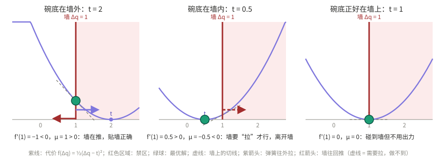
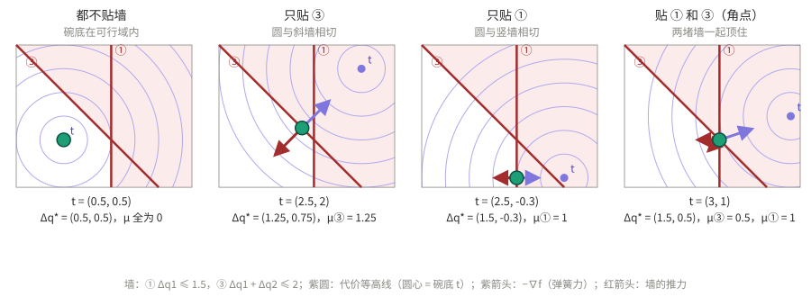

# 有约束 QP 与 KKT 条件：从无约束 QP 讲起

> 本文写给“会解无约束 QP，但不清楚有约束 QP 怎么算”的读者，是 [QP_WBC.md §3](QP_WBC.md#3-qp-基础) 的展开。
> 只用到两样工具：**梯度**和**一阶泰勒展开**。每一步都配有数值例子，可以用 [`tools/active_set_demo.py`](tools/active_set_demo.py) 复现。

---

## 目录

1. [出发点：无约束 QP](#1-出发点无约束-qp)
2. [最优的定义：往允许的方向走，代价都不下降](#2-最优的定义往允许的方向走代价都不下降)
3. [一维：一个变量，一堵墙](#3-一维一个变量一堵墙)
4. [多维：一堵墙](#4-多维一堵墙)
5. [多维：多堵墙（角点）](#5-多维多堵墙角点)
6. [KKT 条件：把所有情况写成一套方程](#6-kkt-条件把所有情况写成一套方程)
7. [怎么求解：Active Set 法](#7-怎么求解active-set-法)
8. [对应到 qpOASES 和 wbc_function](#8-对应到-qpoases-和-wbc_function)

符号：决策变量记为 $\Delta q$（单周期关节增量）；文中的结论与变量叫什么无关，换成 $v = \dot q$ 完全一样。

---

## 1. 出发点：无约束 QP

$$
f(\Delta q) = \tfrac12 \Delta q^T H \Delta q + g^T \Delta q, \qquad H \succ 0
$$

梯度为 $\nabla f = H\Delta q + g$。无约束最优解令梯度为零：

$$
H\Delta q = -g
$$

**梯度的含义**（后面全靠它）：从 $\Delta q$ 出发走一小步 $\varepsilon d$（$d$ 是方向，$\varepsilon > 0$ 很小），一阶泰勒展开给出

$$
f(\Delta q + \varepsilon d) \;\approx\; f(\Delta q) + \varepsilon\, \underbrace{\nabla f^T d}_{\text{沿 } d \text{ 的斜率}}
$$

- $\nabla f^T d < 0$：沿 $d$ 走，代价下降（下坡）；
- $\nabla f^T d > 0$：沿 $d$ 走，代价上升（上坡）。

无约束最优点为什么是 $\nabla f = 0$？因为任何方向都能走：如果 $\nabla f \ne 0$，取 $d = -\nabla f$，斜率 $-\|\nabla f\|^2 < 0$，代价还能下降，就不是最优。

---

## 2. 最优的定义：往允许的方向走，代价都不下降

有约束时，不是所有方向都能走。最优的定义变成：

$$
\boxed{\;\Delta q^* \text{ 最优} \iff \text{对所有允许的方向 } d,\;\; \nabla f(\Delta q^*)^T d \ge 0\;}
$$

即“能走的方向全是上坡（或平的）”。对凸 QP，这个条件既必要又充分。

本文所有推导，都只是把“允许的方向”具体写出来，再看这个条件变成了什么。

**墙的写法**：一条约束 $a^T\Delta q \le b$ 叫一堵墙，向量 $a$ 指向**墙外**（禁区一侧）。球贴着墙时（$a^T\Delta q = b$），往方向 $d$ 走一小步不穿墙的条件是

$$
a^T(\Delta q + \varepsilon d) \le b \iff a^T d \le 0
$$

- $a^T d < 0$：离开墙，往里走；
- $a^T d = 0$：沿着墙滑；
- $a^T d > 0$：往墙外走，**不允许**。

---

## 3. 一维：一个变量，一堵墙

$$
\min_{\Delta q}\; \tfrac12(\Delta q - t)^2 \quad \text{s.t.}\quad \Delta q \le 1
\qquad\Big(f' = \Delta q - t,\;\; a = 1,\;\; b = 1\Big)
$$



**情况 A：不贴墙**（$\Delta q < 1$）。$d$ 可正可负，都允许。要让 $f' \cdot d \ge 0$ 对正负 $d$ 都成立，只能 $f' = 0$。和无约束一样。

**情况 B：贴墙**（$\Delta q = 1$）。允许的方向是 $d \le 0$。要让 $f'(1)\cdot d \ge 0$ 对所有 $d \le 0$ 成立：

$$
f'(1) \le 0
$$

定义 $\mu = -f'(1)$，条件写成 $\mu \ge 0$。

| | $f'(1) = 1 - t$ | $\mu = t - 1$ | 结论 |
|---|---|---|---|
| $t = 2$ | $-1$：往右下坡，但右边不让走 | $1 \ge 0$ | 贴墙是最优 |
| $t = 0.5$ | $0.5$：往左下坡，左边允许走 | $-0.5 < 0$ | 贴墙不是最优，应该离开墙 |

**μ 的物理含义**：把 $-f'$ 看作“弹簧把球拉向 $t$ 的力”，那么 $f' + \mu = 0$ 就是“弹簧力 + 墙的力 = 0”，$\mu$ 是墙对球的推力。$\mu \ge 0$ 说的是：**墙只能推，不能拉**——约束 $\Delta q \le 1$ 只禁止往右，不禁止往左。

---

## 4. 多维：一堵墙

球贴着墙 $a^T\Delta q = b$，记 $\nabla f = \nabla f(\Delta q^*)$。

### 4.1 把梯度分解成“垂直于墙”和“沿着墙”两部分

任何向量都可以分解成平行于 $a$ 的部分和垂直于 $a$ 的部分：

$$
\nabla f = -\mu\, a + r, \qquad r^T a = 0, \qquad \mu = -\frac{a^T \nabla f}{\|a\|^2}
$$

（$\mu$ 前面的负号是为了让后面的结论写成 $\mu \ge 0$。）

### 4.2 沿着墙的方向：和无约束一样，斜率必须为 0

取 $d = r$ 和 $d = -r$。因为 $a^T(\pm r) = 0$，两个方向都是“沿墙滑”，都允许。最优条件要求

$$
\nabla f^T r = \|r\|^2 \ge 0, \qquad \nabla f^T(-r) = -\|r\|^2 \ge 0
\;\;\Longrightarrow\;\; r = 0
$$

所以 $\nabla f = -\mu\, a$，即

$$
\nabla f + \mu\, a = 0
$$

几何上：梯度和墙垂直，代价的等高线与墙**相切**。如果不相切，球还能沿着墙往下滑。

### 4.3 垂直于墙的方向：就是一维的情况

取 $d = -a$（垂直离开墙）。$a^T(-a) = -\|a\|^2 \le 0$，允许。最优条件要求

$$
\nabla f^T(-a) = (-\mu a)^T(-a) = \mu\|a\|^2 \ge 0 \;\;\Longrightarrow\;\; \mu \ge 0
$$

### 4.4 反过来也成立

若 $\nabla f = -\mu a$ 且 $\mu \ge 0$，则对任何允许的方向（$a^T d \le 0$）：

$$
\nabla f^T d = -\mu\, (a^T d) \ge 0
$$

所以这两条正好是“贴墙最优”的**充要条件**：

$$
\boxed{\;\nabla f + \mu\, a = 0, \qquad \mu \ge 0\;}
$$

### 4.5 数值例子

$f = \tfrac12\|\Delta q - t\|^2$（$\nabla f = \Delta q - t$），墙 ③：$\Delta q_1 + \Delta q_2 \le 2$，$a = [1, 1]$，球在 $[1, 1]$。

- $t = [2, 2]$：$\nabla f = [-1, -1] = -1 \cdot a$，$r = 0$，$\mu = 1 \ge 0$。**最优。**
- $t = [0.5, 0.5]$：$\nabla f = [0.5, 0.5] = 0.5\cdot a$，$\mu = -0.5 < 0$。检验：取 $d = -a = [-1, -1]$（往里走），斜率 $\nabla f^T d = -1 < 0$，代价下降。**不是最优**，应离开墙。
- $t = [2, 1]$：球在 $[1, 1]$ 时 $\nabla f = [-1, 0]$，分解得 $\mu = 0.5$、$r = [-0.5, 0.5] \ne 0$。沿墙方向 $d = -r = [0.5, -0.5]$ 的斜率 $= -0.5 < 0$，球会沿墙滑到 $[1.5, 0.5]$，在那里 $\nabla f = [-0.5, -0.5]$，$r = 0$，$\mu = 0.5$。

---

## 5. 多维：多堵墙（角点）



球同时贴着两堵墙 $a_1^T\Delta q = b_1$、$a_2^T\Delta q = b_2$。允许的方向要同时满足 $a_1^T d \le 0$、$a_2^T d \le 0$。

以二维为例（$a_1, a_2$ 不共线），任何向量都能唯一地写成它们的组合：

$$
\nabla f = -\mu_1 a_1 - \mu_2 a_2
$$

**证明 $\mu_1 \ge 0$**：找一个“沿墙 2 滑、离开墙 1”的方向 $d$，即 $a_1^T d = -1$、$a_2^T d = 0$（两个方程两个未知数，能解出来）。它是允许的，斜率为

$$
\nabla f^T d = -\mu_1 (a_1^T d) - \mu_2 (a_2^T d) = \mu_1 \ge 0
$$

同理 $\mu_2 \ge 0$。反过来，若 $\mu_1, \mu_2 \ge 0$，对任何允许的 $d$ 都有 $\nabla f^T d = -\mu_1 a_1^T d - \mu_2 a_2^T d \ge 0$。所以：

$$
\boxed{\;\nabla f + \mu_1 a_1 + \mu_2 a_2 = 0, \qquad \mu_1 \ge 0,\;\; \mu_2 \ge 0\;}
$$

**$\mu_i < 0$ 的含义**：沿着另一堵墙滑、离开墙 $i$，代价会下降。所以墙 $i$ 不该贴。

**数值例子**：墙 ① $\Delta q_1 \le 1.5$（$a_1 = [1, 0]$），墙 ③ $\Delta q_1 + \Delta q_2 \le 2$（$a_3 = [1, 1]$），角点 $[1.5, 0.5]$。

- $t = [3, 1]$：$\nabla f = [-1.5, -0.5] = -\mu_1[1,0] - \mu_3[1,1]$，解得 $\mu_3 = 0.5$、$\mu_1 = 1.0$，都 $\ge 0$。**角点最优。**
- $t = [2.5, 2]$：$\nabla f = [-1, -1.5]$，解得 $\mu_3 = 1.5$、$\mu_1 = -0.5 < 0$。检验：沿 ③ 滑、离开 ① 的方向 $d = [-1, 1]$，斜率 $= 1 - 1.5 = -0.5 < 0$，代价下降。所以球离开 ①，沿 ③ 滑到 $[1.25, 0.75]$，只贴 ③。

**一般情形**（任意维数、任意多堵墙）：结论不变——最优当且仅当存在 $\mu_i \ge 0$ 使 $\nabla f + \sum_{i\,\text{贴墙}} \mu_i a_i = 0$。墙多于维数时组合不再唯一，证明要用 Farkas 引理，但直观含义相同：**下坡方向 $-\nabla f$ 必须被贴着的墙“用正的力”完全顶住。**

---

## 6. KKT 条件：把所有情况写成一套方程

对没贴的墙令 $\mu_i = 0$，前面所有情况可以统一写成四条（$m$ 堵墙 $a_i^T\Delta q \le b_i$）：

$$
\begin{aligned}
&\text{① 原始可行（不穿墙）：} && a_i^T\Delta q \le b_i \\
&\text{② 驻点（力平衡）：} && H\Delta q + g + \textstyle\sum_i \mu_i a_i = 0 \\
&\text{③ 对偶可行（墙只推不拉）：} && \mu_i \ge 0 \\
&\text{④ 互补松弛（不碰墙就没有力）：} && \mu_i\,(b_i - a_i^T\Delta q) = 0
\end{aligned}
$$

| 条件 | 从哪来 | 物理含义 |
|---|---|---|
| ① | 约束本身 | 球不穿墙 |
| ② | §4.2：沿墙方向斜率为 0 | 弹簧力与墙的推力平衡 |
| ③ | §4.3 / §5：离墙方向不能是下坡 | 墙只能推，不能拉 |
| ④ | 没贴的墙不限制任何方向 | 不接触就没有作用力 |

没有约束时只剩 ②，且 $\mu = 0$，就是 $H\Delta q + g = 0$。**无约束 QP 是 KKT 条件的特例。**

**μ 的另一个含义**：μ 等于“把这堵墙往外挪一点，最优代价能下降多少”（灵敏度）。μ 越大，这条约束卡得越狠。WBC 中可以据此找出是哪个关节限位、哪条约束限制了末端。

---

## 7. 怎么求解：Active Set 法

### 7.1 知道哪些墙贴着，就只剩解线性方程组

设贴着的墙集合为 $W$（working set）。对 $W$ 中的墙，④ 要求 $a_i^T\Delta q = b_i$；对 $W$ 外的墙，$\mu_i = 0$。代入 ②，得到关于 $(\Delta q, \mu_W)$ 的**线性方程组**：

$$
\begin{bmatrix} H & A_W^T \\ A_W & 0 \end{bmatrix}
\begin{bmatrix} \Delta q \\ \mu_W \end{bmatrix}
=
\begin{bmatrix} -g \\ b_W \end{bmatrix}
$$

$A_W$ 是 $W$ 中各墙的 $a_i^T$ 堆成的矩阵。$W$ 为空时，它就是 $H\Delta q = -g$。

解出来之后，②④ 已经自动满足，只剩两个**不等式**要检查：
- ①：有没有穿过 $W$ 以外的墙？
- ③：$W$ 中有没有 $\mu_i < 0$？

**整个有约束 QP 的难点，就是找到一个 $W$，让这两项检查都通过。**

### 7.2 迭代：每次加一堵墙或去掉一堵墙

```
从一个可行点 Δq 和集合 W 出发（W 可以为空，也可以是上一周期的结果）
循环：
  1. 解 7.1 的方程组 → Δq_W, μ_W
  2. 若 Δq_W ≠ Δq：从 Δq 朝 Δq_W 走，碰到第一堵墙就停，把它加入 W     ← 修复 ①
  3. 若 Δq_W = Δq：若有 μ_i < 0，把墙 i 移出 W                         ← 修复 ③
  4. 否则：KKT 四条全部满足，得到最优解
```

第 2 步“碰到第一堵墙”的计算（比值检验）：沿 $\Delta q + \alpha p$（$p = \Delta q_W - \Delta q$）前进，对每堵 $a_i^T p > 0$ 的墙，碰到它的步长为 $\alpha_i = (b_i - a_i^T\Delta q)/(a_i^T p)$；取 $\alpha = \min(1, \min_i \alpha_i)$。

### 7.3 例子（`python3 tools/active_set_demo.py` 的输出）

**例 1**：目标 $[2, 2]$，墙 ①②③，从原点冷启动。

| 迭代 | W | 解方程组 | 动作 |
|---|---|---|---|
| 1 | {} | $\Delta q_W = [2, 2]$ | 朝它走：$\alpha_③ = 2/4 = 0.5$，$\alpha_{①} = \alpha_{②} = 1.5/2 = 0.75$。走到 50% 碰到 ③，停在 $[1, 1]$，加入 ③ |
| 2 | {③} | $\Delta q_W = [1, 1]$，$\mu_③ = 1$ | 原地不动，$\mu \ge 0$，结束 |

**例 2**：下一周期目标变成 $[0.5, 0.5]$，**热启动**：从 $[1, 1]$、$W = \{③\}$ 出发。

| 迭代 | W | 解方程组 | 动作 |
|---|---|---|---|
| 1 | {③} | $\Delta q_W = [1, 1]$，$\mu_③ = -0.5$ | $\mu < 0$，移出 ③ |
| 2 | {} | $\Delta q_W = [0.5, 0.5]$ | 一路没碰墙，走到 $[0.5, 0.5]$ |
| 3 | {} | 原地不动 | 结束 |

**例 3**：目标 $[3, 1]$，墙 ① 和 ③，冷启动。从原点朝 $[3,1]$ 走时，① 和 ③ 在 $\alpha = 0.5$ 处**同时**被碰到（都在角点 $[1.5, 0.5]$），所以先加入 ①，下一步原地再加入 ③，最后 $\mu_① = 1.0$、$\mu_③ = 0.5$，角点最优。qpOASES 给出相同结果。

### 7.4 为什么 WBC 里它很快

- 每次迭代只解一个小线性方程组；实际求解器还会增量更新矩阵分解，不必每次从头解。
- 相邻控制周期的问题几乎一样，上一周期的 $W$ 往往就是答案或只差一两堵墙。**热启动**通常 1~2 次迭代就结束（例 2）。

---

## 8. 对应到 qpOASES 和 wbc_function

| 本文概念 | qpOASES / wbc_function |
|---|---|
| 墙 $a_i^T\Delta q \le b_i$ | 线性约束 `A`、`lbA`、`ubA`（上下两侧各算一堵墙） |
| 只涉及单个变量的墙 | Box 约束 `lb`、`ub`（`a_i` 是单位向量，求解器有专门的快速处理） |
| 软约束 | 多一个变量 $s$ 和两堵墙（[QP_WBC.md §6](QP_WBC.md#6-软约束与松弛变量)），算法完全相同 |
| 迭代次数（加墙 / 去墙的次数） | `WBCResult.n_iter` |
| 从空集开始 / 从上一周期的 $W$ 开始 | 冷启动 `qp_init` / 热启动 `qp_hotstart` |
| 最终的 $W$ 和 μ | 对偶解 → `WBCResult.active_bounds`、`active_constraints` |

**符号约定**：本文对 $a^T\Delta q \le b$ 写成 $\nabla f + \mu a = 0$，$\mu \ge 0$。qpOASES 的约束是双边的 $lb \le \cdot \le ub$，它的对偶解约定为：**下界 active 时为正，上界 active 时为负**。`wbc_function` 已统一转换为 `-1`（下界 active）、`+1`（上界 active）、`0`（未 active）。

qpOASES 实际使用的是**参数化 active set**：热启动时把上一周期的问题连续变形成本周期的问题，沿途记录 $W$ 的变化。思路与 §7 相同，只是更稳健。
