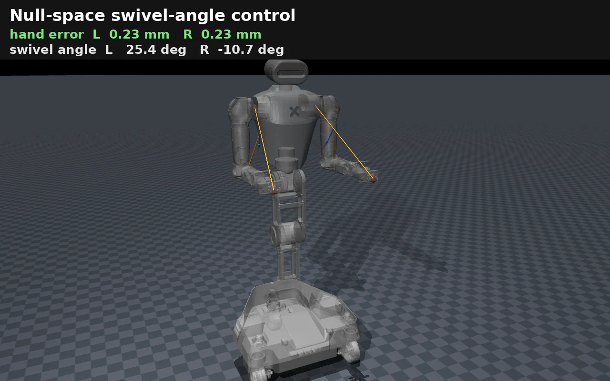
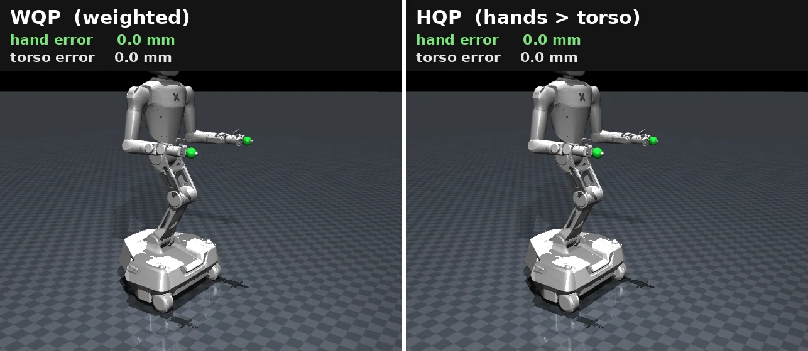
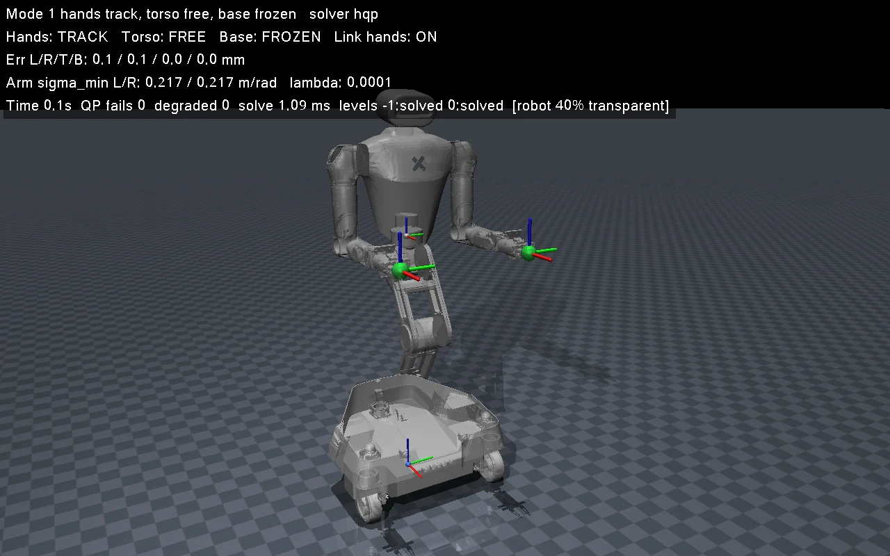

# 轮式双臂机器人全身控制

**Whole-Body Control for a Wheeled Dual-Arm Robot — from scratch**

底盘、躯干、双臂协同的运动学全身控制：加权最小二乘 · 零空间投影 · 加权 QP · 分层 QP

[本仓库做什么](#本仓库做什么) · [文档](#文档) · [演示](#演示臂角零空间控制) · [文件说明](#文件说明) · [实验与验证](#实验与验证)

---

## 本仓库做什么

让机械臂末端精确到达指定空间位姿，同时利用冗余自由度（零空间）完成次任务（姿态优化、臂角摆动等）。目标可能超出手臂可达范围，需要底盘、躯干、手臂协同运动来完成任务。

冗余机器人全身控制方法按两个维度分为四类（**优先级方式** × **能否处理不等式约束**），本仓库的实现情况：

| | 无不等式约束（闭式解） | 有不等式约束（QP 求解器） |
|---|---|---|
| **加权** | ✅ **方法1：加权最小二乘** — `wbc_function/wls_solver.py` | ✅ **方法3：加权 QP（WQP）** — `wbc_function/wqp_solver.py`（qpOASES） |
| **严格分层** | ✅ **方法2：零空间投影** — 演示见 `demo_nullspace_scenarios.py`、`demo_nullspace_real.py`、`demo_arm_angle_swivel.py` | ✅ **方法4：分层 QP（HQP）** — `wbc_function/hqp_solver.py`（qpOASES，逐层求解）；交互演示 `demo_hqp_interactive.py` |

## 文档

| 文档 | 内容 |
|---|---|
| [WBC_PRINCIPLES.md](WBC_PRINCIPLES.md) | 原理：四种方法的分类与对比（第一章）、零空间投影推导（第二章） |
| [QP_KKT_GUIDE.md](QP_KKT_GUIDE.md) | 入门：从无约束 QP 出发理解 KKT 条件和有约束 QP 的迭代求解（Active Set），配数值例子 |
| [QP_WBC.md](QP_WBC.md) | 运动学 QP-WBC：加权最小二乘（本项目实现）、加权 QP 与分层 QP 的推导、约束建模、分层求解的完整例子（双手、躯干、底盘、安全盒）、求解器与实现 |

## 演示：臂角零空间控制

双手末端固定为主任务，臂角 ψ（肘部绕肩-腕轴自转的相位）按正弦轨迹摆动为次任务，验证零空间投影不影响末端精度。画面中机身半透明，橙色线为肩–腕连线和肘部的径向投影，二者确定臂角；顶部实时显示双手误差和两臂的臂角。原理见 [WBC_PRINCIPLES.md 第二章 2.7 节](WBC_PRINCIPLES.md#27-案例用标准臂角-psi-驱动零空间速度)，代码见 `demo_arm_angle_swivel.py`。

## 演示：分层 QP 与加权 QP 对比

双手保持不动（绿色球为双手目标），躯干目标被拉到手臂补偿不了的位置（橙色球）。两边的目标和增益完全相同：

- **左：加权 QP**。双手和躯干在同一个目标函数里按权重折中，躯干把双手拖离了目标；
- **右：分层 QP**。双手在高层，躯干在低层：双手始终停在目标上，躯干只在不影响双手的范围内尽量靠近目标。

## 演示：可拖拽目标点的 HQP 交互仿真

迁移自 AlphaBrainSystem 的 `mujoco_hqp_interactive.cpp`，操作方式、四种控制模式（手 / 躯干的 跟踪 / 自由 / 冻结 组合）、状态机、插值、初始姿态的设计、无窗口自检和数据记录格式都与 C++ 版一致，求解换成本仓库的 `WholeBodyController(solver="hqp")`：躯干安全盒在第 -1 层，双手在第 0 层，躯干在第 1 层。默认机器人是 `assets/` 中原始 URDF 的 R1 Pro，完整说明见 `demo_hqp_interactive.py` 开头。

视频依次演示（机身 40% 透明，便于看到目标球）：

1. **双手前伸**：躯干自由，和手臂一起把双手送到更远的放置点；
2. **拖动躯干**：躯干后移、下降，双手在世界坐标系中保持不动；
3. **冻结手臂**：只动躯干，双手随身体移动；
4. **压力测试点**：双手目标远超可达范围，目标球变红，双手尽力靠近，不抖动；
5. **回到初始姿态**：所有关节在关节空间平滑回位。

主要功能：Ctrl + 拖动目标球（可锁定沿 X / Y / Z 轴），数字键切换四种控制模式，双手联动（端托盘）、放置点、压力测试点、回初始姿态、机身透明等快捷键；底盘可选参与规划；可切换为加权 QP / 加权最小二乘对照；无窗口自检（四种模式 + A/B 对照）；记录每个周期的关节和末端数据，用 `tools/plot_trace.py` 画图。

**换机器人（适配其他 URDF）**：程序里没有写死任何机器人信息，全部来自 [robots.py](robots.py) 的 `RobotConfig`（关节分组、末端、躯干坐标系、初始姿态、安全盒）。任意 URDF 可以用通用加载器 `robots.load_urdf()` 加载，它在加载时补上执行器（增益按关节惯量整定）、末端 site、重力补偿、地面，可选平面底盘。接入新机器人写一个 JSON 配置即可（格式见 `robots.load_config_file`）；内置的 `r1_urdf` 就是用通用加载器加载同一个 R1 URDF。

## 文件说明

**根目录**

| 位置 | 说明 |
|---|---|
| `wbc_function/` | 核心库：WBC 求解器（写应用用它，见下表） |
| `robot_model.py` | 模型加载、关节名常量、HOME_POSE |
| `robots.py` | 机器人配置 `RobotConfig` + 通用 URDF 加载器（适配不同机器人） |
| `simulate.py` | 单臂到达仿真（运动学 / 动态） |
| `demo_*.py` | 零空间投影演示；`demo_hqp_interactive.py` 为 HQP 交互仿真 |
| `nullspace_example.py` | 加权 vs 零空间的数值对比（非真实机器人） |
| `test_wbc_function.py`、`test_dual_arm_ground.py`、`run_all_tests.sh` | 测试 |
| `tools/` | 离线工具（模型转换、可视化、绘图、README 动图录制） |
| `assets/` | 机器人模型（URDF / MJCF / 网格） |
| `WBC_PRINCIPLES.md`、`QP_KKT_GUIDE.md`、`QP_WBC.md`、`README_pics/` | 文档与配图 |

**核心库：`wbc_function/`**

| 文件 | 说明 |
|---|---|
| `wls_solver.py` | `WLSSolver`：加权最小二乘，闭式解，无不等式约束 |
| `wqp_solver.py` | `WQPSolver`：加权 QP，用 qpOASES 求解，支持关节限位、线性（软）约束 |
| `hqp_solver.py` | `HQPSolver`：分层 QP，按任务 `priority` 逐层求解（每层 qpOASES），软约束可作为单独一层 |
| `qp_builder.py` | WQP / HQP 共用的 QP 组装（软约束松弛变量、等式块）、结果回读、qpOASES 对象缓存 |
| `wbc_controller.py` | `WholeBodyController`：全身控制器（应用层），可跟踪末端、躯干、底盘。组合下面的组件，可选 `solver="wls"`（原实现）、`"wqp"` 或 `"hqp"`；`simulate.py`、`demo_*` 都用它 |
| `problem.py` | 问题描述：`Task`、`LinearConstraint`、`WBCProblem`、`WBCResult`，三个求解器共用 |
| `tasks.py` | 任务 / 约束构造函数（`pose_task`、`joint_velocity_bounds`、`linearized_constraint` 等），姿态误差等工具 |
| `kinematics.py` | `MujocoKinematics`：从 MuJoCo 取受控自由度的 q、限位、雅可比、位姿 |
| `qpoases_interface.py` | qpOASES 的 Python 封装：查找安装位置、编译并加载桥接库 |
| `qpoases_bridge.cpp` | qpOASES 的 C 接口；首次使用 QP 求解器时自动编译到 `wbc_function/_build/`（不入库） |

**仿真与演示**

| 文件 | 说明 |
|---|---|
| `simulate.py` | 单臂到达仿真 + 自动判定（运动学 / 动态双模式） |
| `demo_nullspace_scenarios.py` | 零空间投影：双手固定 + 肘部 / 底盘协同运动 |
| `demo_nullspace_real.py` | 零空间投影：末端固定 + 肘部 / 躯干自由运动 |
| `demo_arm_angle_swivel.py` | 标准臂角 ψ 零空间控制（解析雅可比 + 有限差分校验），可画出臂角的几何量 |
| `demo_hqp_interactive.py` | HQP 交互仿真（迁移自 AlphaBrainSystem，机器人由 `robots.py` 配置）：拖拽目标、四种控制模式、无窗口自检 |
| `nullspace_example.py` | 加权与零空间方法的数值对比（非真实机器人） |

**测试**

| 文件 | 说明 |
|---|---|
| `test_wbc_function.py` | qpOASES 桥接、软约束、与原控制器一致性、闭环到达（WLS vs WQP）、HQP（严格优先级、与零空间投影一致、软约束分层、锁定退化、控制器分层）、机器人配置与交互仿真自检 |
| `test_dual_arm_ground.py` | 双臂够地面压力测试 |
| `run_all_tests.sh` | 依次运行模型转换、仿真、wbc_function 测试、雅可比校验 |

**工具（`tools/`）**

| 文件 | 说明 |
|---|---|
| `tools/convert_urdf.py` | URDF → MJCF 转换（自动调谐伺服增益）；可生成带相机网格的版本 |
| `tools/convert_glb.py` | 把 RealSense d435 的 GLB 网格转成 OBJ（带相机的版本需要） |
| `tools/active_set_demo.py` | 教学用 Active Set 求解器，逐步打印迭代过程，并与 qpOASES 对照（配合 QP_KKT_GUIDE.md） |
| `tools/visualize_nullspace.py` | 平面机械臂零空间运动的 matplotlib 可视化 |
| `tools/plot_trace.py` | HQP 交互仿真记录数据的绘图（需要 matplotlib） |
| `tools/record_readme_videos.py` | 生成本 README 中的三个演示动图 |

## wbc_function 用法

两种用法：

- **直接用组件**：用 `MujocoKinematics` 固定受控自由度的顺序、取限位和雅可比；每个控制周期构造一个 `WBCProblem`，加入任务（末端位姿、关节姿态等）、上下界和线性约束，交给 `WLSSolver` / `WQPSolver` / `HQPSolver` 中的任意一个求解，三者共用同一套问题描述，换求解器只需换一行。
- **用 `WholeBodyController`（推荐）**：任务是常驻对象，运行时随时修改目标、前馈速度、开关、权重和优先级；可冻结任意一组关节；可注册常驻约束（如躯干安全盒）和自定义任务（如臂角）；每个周期调用一次求解，返回关节速度和各任务的误差。

接口与原理的对应、控制器的完整用法见 [QP_WBC.md §11](QP_WBC.md#11-代码结构wbc_function)。QP 求解器第一次使用时会用 g++ 编译一个 qpOASES 桥接库；qpOASES 不在 conda 默认位置时，设置环境变量 `QPOASES_ROOT` 指向其安装前缀（含 `include/qpOASES.hpp` 和 `lib/libqpOASES.so`）。

## 实验与验证

以下是加权最小二乘 WBC（原理见 [QP_WBC.md §1](QP_WBC.md#1-加权最小二乘本项目实现)）的运行与验证记录。运行方式见各脚本开头的说明。

### 验证场景

- 近处目标（手臂够得到）、远处目标（需要底盘移动）、禁用底盘的对照组；
- 指定末端姿态；
- 运动学模式与动态模式（物理伺服驱动，有重力和执行器延迟）；
- 双臂够地面；
- 改用加权 QP（关节限位作为硬约束）；
- wbc_function 测试（WLS / WQP / HQP）、完整测试套件。

### 验证结果

| 场景 | 位置误差 | 姿态误差 | 收敛时间 | 结果 |
|---|---|---|---|---|
| 近处目标（运动学） | 2.96 mm | 0.00° | 1.10 s | ✅ PASS |
| 近处目标（动态） | 9.1 mm | 0.07° | 1.34 s | ✅ PASS |
| 远处目标（启用底盘） | < 10 mm | < 3° | < 2 s | ✅ PASS |
| 远处目标（禁用底盘） | > 500 mm | — | — | ❌ FAIL |
| 双臂够地面 0.25 m | 5.96 mm | 0.01° | 0.99 s | ✅ PASS |
| 雅可比校验 | 4.6e-07 | — | — | ✅ OK |

**WLS vs WQP**（`test_wbc_function.py`，`WholeBodyController` 两种模式，远处目标 (1.2, -1.5, 1.0)，运动学积分）：

| 模式 | 最终误差 | 收敛时间 | 关节越限 | 单次求解（平均 / p99） |
|---|---|---|---|---|
| `solver="wls"`（原实现：求解后裁剪） | 0.00 mm | 1.30 s | 无 | 0.21 / 2.9 ms |
| `solver="wqp"`（限位为硬约束） | 0.00 mm | 0.63 s | 无 | 0.09 / 0.15 ms |

WQP 在速度饱和时保持运动方向，所以收敛更快。`solver="wls"` 与重构前的控制器逐步一致（回归测试最大差 1e-12）。求解耗时受机器负载影响，仅供参考。

**核心验证点**：同一目标，仅用手臂无法到达（误差 > 50 cm），加入底盘后达到毫米级精度。

**运动学 vs 动态**：
- **运动学模式**：直接积分速度，无重力 / 摩擦，验证控制器数学
- **动态模式**：真实物理伺服，有重力补偿、执行器延迟和碰撞检测

### 质量保证

1. **雅可比有限差分校验**（`check_jacobian()`，启动时执行）：
   - 对每个受控自由度施加微小扰动 $\epsilon = 10^{-6}$
   - 用正运动学测量末端实际位姿变化，与雅可比对应列比较
   - 当前最大误差约 $4.6 \times 10^{-7}$ ✅
2. **收敛判定**（`simulate.py`）：
   - 位置误差 < 1 cm **且**姿态误差 < 0.05 rad（约 2.9°）
   - 连续保持 50 步（$dt = 2$ ms，即 0.1 s）
   - 中途回升则重置计数
3. **最终裁决**：PASS 需同时满足位置和姿态容差

### 扩展方向

- ✅ 双臂协同（`test_dual_arm_ground.py`）
- ✅ 动力学模式验证（运动学 / 动态双模式通过）
- ✅ 加权 QP：关节限位、速度限位、线性（软）约束（`wbc_function.WQPSolver`，[QP_WBC.md §7](QP_WBC.md#7-加权-qpwqp)）
- ✅ 分层 QP：末端任务严格优先（`wbc_function.HQPSolver`，[QP_WBC.md §8](QP_WBC.md#8-分层-qphqp)）
- ✅ 可拖拽目标点的 HQP 交互仿真，适配多种 URDF（`demo_hqp_interactive.py`、`robots.py`）
- ⏳ 把 `simulate.py`、`demo_*.py` 迁移到 `wbc_function`
- ⏳ 差速轮底盘模型（非完整约束）
- ⏳ 实时碰撞约束
- ⏳ MPC 轨迹优化（多步预测）
- ⏳ 力控模式（阻抗控制）

### MuJoCo 迁移说明

本项目已从 PyBullet 完全迁移到 MuJoCo。主要改进：

1. **雅可比精度**：有限差分校验误差从 $5 \times 10^{-4}$ 降至 $4.6 \times 10^{-7}$
2. **底盘雅可比**：底盘建模为真实关节，由 MuJoCo 直接给出，不再需要手工推导
3. **自动增益调谐**：基于质量矩阵的二阶系统参数化（`kp = ω²M`，`kv = 2ζωM`）
4. **动态模式**：位置伺服驱动，支持重力补偿和执行器建模
5. **模块化**：控制器与物理引擎解耦，便于真机部署
