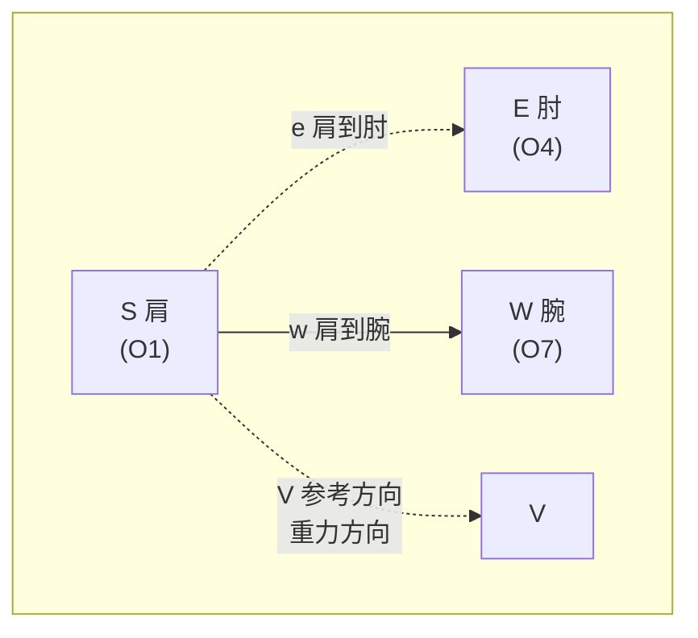
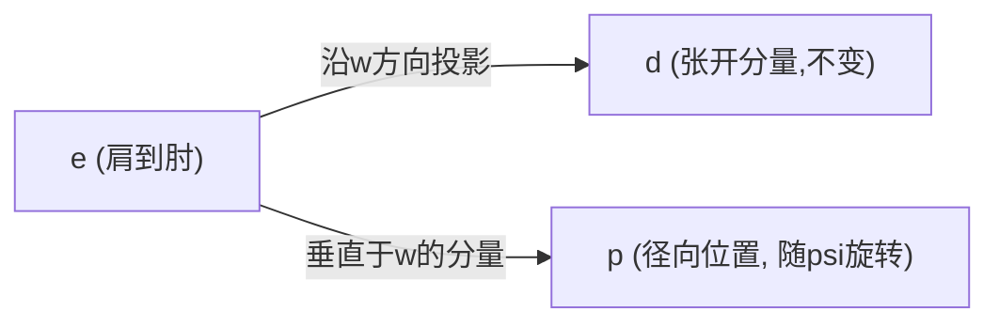

# WBC - 全身控制器设计详解

**目标**：控制一台轮式双臂机器人（Galaxea R1 Pro），让机械臂末端精确到达指定的空间位姿。

**关键问题**：目标可能很远，单靠手臂够不到 → 需要底盘、躯干、手臂**协同运动**。

**物理引擎**：MuJoCo 3.2+ （提供高精度运动学、动力学和碰撞检测）

**本文档包含三章**：
- **第一章**：基于加权最小二乘的WBC（本项目实现）
- **第二章**：三种WBC方法对比（总览）
- **第三章**：零空间优化的数学推导（深入理论）

---

[TOC]

---

# 第一章 基于加权最小二乘的WBC（本项目实现）

> **方法类型**：加权阻尼最小二乘（Weighted Damped Least Squares）  
> **特点**：闭式解、计算快速（~0.3ms）、主次任务混合优化  
> **适用场景**：实时控制、冗余度机器人

---

## 1.1 核心思想

把机器人看作一个**整体**，联合规划：
- **底盘**（3 自由度：前后 x、左右 y、转向 yaw）
- **躯干**（4 个关节）
- **手臂**（左右各 7 个关节，单臂任务时仅规划一侧）

每个控制周期（如 2 ms），计算出所有关节和底盘应该以什么**速度**运动，才能让末端最快接近目标。

---

## 1.2 数学建模

### 1.2.1 状态向量

定义全身速度向量（单臂任务：14 维；双臂任务：21 维）：

$$
\mathbf{v} = \begin{bmatrix} \dot{\mathbf{q}}_{\text{base}} \\ \dot{\mathbf{q}}_{\text{torso}} \\ \dot{\mathbf{q}}_{\text{arms}} \end{bmatrix}
$$

其中：
- $\dot{\mathbf{q}}_{\text{base}} = [\dot{x}, \dot{y}, \dot{\theta}_{\text{yaw}}]^T$ —— 底盘在世界坐标系中的速度（3 维）
- $\dot{\mathbf{q}}_{\text{torso}}$ —— 躯干的 4 个关节角速度
- $\dot{\mathbf{q}}_{\text{arms}}$ —— 手臂关节角速度（单臂 7 维，双臂 14 维）

### 1.2.2 末端速度与全身速度的关系

末端的 6 维速度（3 维线速度 + 3 维角速度）可以表示为：

$$
\dot{\mathbf{x}}_{\text{ee}} = \mathbf{J} \cdot \mathbf{v}
$$

这里 $\mathbf{J}$ 是**任务雅可比矩阵**（6×13），它描述了"每个自由度变化 1 单位，末端会移动多少"。

**$\mathbf{J}$ 的构造**：

在 MuJoCo 中，底盘被建模为三个真实的关节（`base_x`, `base_y`, `base_yaw`），因此 $\mathbf{J}$ 由 `mj_jacSite()` 一步计算完成，无需手工拼接底盘项和手臂项。

**原理等价性**：虽然实现方式变了，但数学原理与手工推导完全一致：

#### （手工推导参考）底盘部分 $\mathbf{J}_{\text{base}}$（6×3）

底盘运动如何影响末端？用刚体速度公式：

$$
\begin{aligned}
\text{线速度:} \quad \mathbf{v}_{\text{ee}} &= \mathbf{v}_{\text{base}} + \boldsymbol{\omega}_{\text{base}} \times \mathbf{r} \\
\text{角速度:} \quad \boldsymbol{\omega}_{\text{ee}} &= \boldsymbol{\omega}_{\text{base}}
\end{aligned}
$$

其中 $\mathbf{r}$ 是从底盘中心到末端的位置向量。

因为底盘只能平面运动（yaw 转向），所以：
- $\mathbf{v}_{\text{base}} = [v_x, v_y, 0]^T$
- $\boldsymbol{\omega}_{\text{base}} = [0, 0, \omega_{\text{yaw}}]^T$

展开叉乘 $\boldsymbol{\omega}_{\text{base}} \times \mathbf{r}$：

$$
[0, 0, \omega_{\text{yaw}}] \times [r_x, r_y, r_z] = [-r_y \cdot \omega_{\text{yaw}}, r_x \cdot \omega_{\text{yaw}}, 0]
$$

所以底盘雅可比为：

$$
\mathbf{J}_{\text{base}} = \begin{bmatrix}
1 & 0 & -r_y \\
0 & 1 & r_x \\
0 & 0 & 0 \\
0 & 0 & 0 \\
0 & 0 & 0 \\
0 & 0 & 1
\end{bmatrix}
\begin{matrix}
\leftarrow \text{x 方向线速度} \\
\leftarrow \text{y 方向线速度} \\
\leftarrow \text{z 方向线速度（底盘不能飞）} \\
\leftarrow \text{roll 角速度（底盘不能倾斜）} \\
\leftarrow \text{pitch 角速度} \\
\leftarrow \text{yaw 角速度}
\end{matrix}
$$

#### （实际实现）MuJoCo 自动计算

```python
# wbc_controller.py:178-185
jacp = np.zeros((3, model.nv))  # 线速度雅可比
jacr = np.zeros((3, model.nv))  # 角速度雅可比
mujoco.mj_jacSite(model, data, jacp, jacr, site_id)
J = np.vstack([jacp[:, controlled_dofs], jacr[:, controlled_dofs]])
```

MuJoCo 返回的 $\mathbf{J}$ 已包含底盘三个关节的列，其数值与上述手工推导等价，但由编译后的模型自动计算，避免了手工推导底盘项时可能出现的坐标系错误。

---

## 1.3 控制问题：速度层 QP

### 1.3.1 主任务：跟踪末端目标

当前末端位姿与目标位姿有误差 $\mathbf{e}_{\text{pose}}$（6 维：3 位置 + 3 姿态）。

用**比例控制**，期望末端速度为：

$$
\dot{\mathbf{x}}_{\text{desired}} = K \cdot \mathbf{e}_{\text{pose}}
$$

其中 $K$ 是增益（如 $K=2$，表示"每秒消除误差的 200%"，实际是指数收敛）。

结合雅可比，我们希望：

$$
\mathbf{J} \cdot \mathbf{v} \approx K \cdot \mathbf{e}_{\text{pose}}
$$

但这是一个**欠定系统**（方程数 < 变量数），有无穷多解。我们需要加约束。

### 1.3.2 次任务：姿态正则 + 避免奇异

不希望机器人为了完成任务而扭成奇怪的姿态，所以加一个**正则项**：

$$
\mathbf{v} \text{ 应该接近 } \mathbf{v}_{\text{posture}} \text{（期望姿态速度）}
$$

其中 $\mathbf{v}_{\text{posture}}$ 定义为"拉向关节中位"的速度：

$$
v_{\text{posture},i} = k_{\text{posture}} \cdot (q_{\text{mid},i} - q_{\text{current},i})
$$

同时加一个**阻尼项** $\lambda \|\mathbf{v}\|^2$，防止雅可比奇异时速度爆炸。

### 1.3.3 完整的 QP 目标函数

最小化：

$$
\mathcal{L}(\mathbf{v}) = \|\mathbf{J}\mathbf{v} - K\mathbf{e}_{\text{pose}}\|^2_{\mathbf{W}} + \lambda\|\mathbf{v}\|^2 + \|\mathbf{v} - \mathbf{v}_{\text{posture}}\|^2_{\mathbf{W}_p}
$$

其中：
- $\mathbf{W}$ —— 任务权重矩阵（位置权重高于姿态）
- $\lambda$ —— Tikhonov 阻尼系数（典型值 0.01）
- $\mathbf{W}_p$ —— 姿态正则权重（底盘权重极小，关节权重适中）

---

## 1.4 闭式解（无需 QP 求解器）

展开目标函数，求导并令其为零：

$$
\frac{\partial \mathcal{L}}{\partial \mathbf{v}} = 2(\mathbf{J}^T \mathbf{W} \mathbf{J} + \lambda \mathbf{I} + \mathbf{W}_p)\mathbf{v} - 2\mathbf{J}^T \mathbf{W} K\mathbf{e}_{\text{pose}} - 2\mathbf{W}_p\mathbf{v}_{\text{posture}} = 0
$$

整理得：

$$
\mathbf{A}\mathbf{v} = \mathbf{b}
$$

其中：
- $\mathbf{A} = \mathbf{J}^T \mathbf{W} \mathbf{J} + \lambda \mathbf{I} + \mathbf{W}_p$
- $\mathbf{b} = \mathbf{J}^T \mathbf{W} K\mathbf{e}_{\text{pose}} + \mathbf{W}_p\mathbf{v}_{\text{posture}}$

直接求解：

$$
\mathbf{v} = \mathbf{A}^{-1} \mathbf{b}
$$

这是一个**线性方程组**，用 `np.linalg.solve()` 即可，不需要外部 QP 求解器。

---


## 1.5 关键设计技巧

### 1.5.1 让底盘"自由地"参与规划

设置 $\mathbf{W}_p$ 时：
- 底盘自由度的权重设为极小值（如 $10^{-6}$）
- 关节自由度的权重设为正常值（如 $0.1$）

**效果**：当目标远时，底盘会"主动"移动；当目标近时，底盘保持静止，手臂完成任务。

### 1.5.2 位置优先，姿态次要

设置 $\mathbf{W}$ 时：
- 位置误差权重 = 1.0
- 姿态误差权重 = 0.1

**效果**：先把末端移到对的地方，再慢慢调整朝向。

---


## 1.6 实现与验证

### 文件说明

| 文件 | 作用 |
|------|------|
| `convert_urdf.py` | URDF→MJCF转换器 + 自动增益调谐 |
| `wbc_controller.py` | 核心：`WholeBodyController` 类，实现上述 QP 求解（MuJoCo API） |
| `robot_model.py` | 模型加载抽象、标记管理、HOME_POSE 定义 |
| `simulate.py` | MuJoCo 仿真 + 自动化测试（运动学/动力学双模式） |
| `test_dual_arm_ground.py` | 双臂够地面测试（扩展为多末端任务） |

### 运行示例

```bash
# 安装依赖
pip install mujoco==3.2.7 numpy==1.26.4

# 首次运行：转换URDF为MJCF（自动调谐伺服增益）
python convert_urdf.py

# 基础测试：近处目标（手臂够得到）
python simulate.py --headless

# 远处目标：需要底盘移动
python simulate.py --headless --target 1.2 -1.5 1.0

# 对照组：禁用底盘（会失败）
python simulate.py --headless --no-base --target 1.2 -1.5 1.0

# 指定末端姿态
python simulate.py --headless --target-rpy 0 0.5 -0.3

# 动态模式：物理伺服驱动（有重力和执行器延迟）
python simulate.py --headless --dynamic

# 双臂够地面
python test_dual_arm_ground.py --headless --ground-z 0.25

# 交互式查看器（需要图形界面）
python simulate.py
```

### 验证结果

| 场景 | 位置误差 | 姿态误差 | 收敛时间 | 结果 |
|------|---------|---------|---------|------|
| 近处目标（运动学） | 2.96 mm | 0.00° | 1.10 s | ✅ PASS |
| 近处目标（动态） | 9.1 mm | 0.07° | 1.34 s | ✅ PASS |
| 远处目标（启用底盘） | <10 mm | <3° | <2 s | ✅ PASS |
| 远处目标（禁用底盘） | >500 mm | — | — | ❌ FAIL |
| 双臂够地面 0.25m | 5.96 mm | 0.01° | 0.99 s | ✅ PASS |
| 雅可比校验 | 4.6e-07 | — | — | ✅ OK |

**核心验证点**：同一目标，仅手臂无法到达（误差 >50 cm），加入底盘后达到毫米级精度。

**运动学 vs 动态**：
- **运动学模式**：直接积分速度，无重力/摩擦，验证控制器数学
- **动态模式**：真实物理伺服，有重力补偿、执行器延迟和碰撞检测

---


## 1.7 质量保证

### 自动化检查点

1. **雅可比有限差分校验**：启动时自动执行
   - 对每个自由度施加微小扰动 $\Delta q$
   - 用正向运动学测量末端实际位姿变化 $\Delta \mathbf{x}$
   - 检查 $\|\Delta \mathbf{x} - \mathbf{J} \cdot \Delta q\| < 10^{-3}$
   - 当前误差约 $5 \times 10^{-4}$ ✅

2. **收敛判定**：
   - 位置误差 < 1 cm **且** 姿态误差 < 3°
   - 连续保持 50 步（0.5 秒）
   - 中途回升则重置计数

3. **最终裁决**：PASS 需同时满足位置和姿态容差

---


## 1.8 已知限制

1. **底盘模型简化**：
   - 当前：假设底盘可横向平移（理想平面关节）
   - 现实：差速轮底盘不能侧向移动
   - 真机部署时需要替换为差速驱动模型或非完整约束

2. **关节限位**：当前用软斥力，未来可改为硬约束（需要二次锥规划求解器）

3. **碰撞约束**：自碰撞检测在物理引擎中已启用，但尚未作为QP不等式约束集成

---


## 1.9 扩展方向

- ✅ 双臂协同（已实现：`test_dual_arm_ground.py`）
- ✅ 动力学模式验证（运动学/动态双模式通过）
- ⏳ 差速轮底盘模型（非完整约束）
- ⏳ 实时碰撞约束（不等式约束QP）
- ⏳ MPC轨迹优化（多步预测）
- ⏳ 力控模式（阻抗控制）

---


---

# 第二章 三种WBC方法对比（总览）

> 本章对比三种WBC实现方法，帮助读者选择适合的方案。

---

## 2.1 冗余度与零空间

**冗余度**：关节自由度 > 任务维度

例如：14个关节（3底盘+4躯干+7手臂）控制6维末端任务（3位置+3姿态）
$$
\text{冗余度} = 14 - 6 = 8
$$

**零空间**：完成主任务后剩余的自由度空间

数学定义：
$$
\mathcal{N}(\mathbf{J}) = \{ \mathbf{v} \in \mathbb{R}^{n} \mid \mathbf{J}\mathbf{v} = \mathbf{0} \}
$$

**物理含义**：$\mathbf{v} \in \mathcal{N}(\mathbf{J})$ 表示关节以速度 $\mathbf{v}$ 运动时，末端速度为零。

---

## 2.2 方法1：加权最小二乘

**本项目采用的方法**（详见第一章）

**目标函数**：
$$
\min_{\mathbf{v}} \|\mathbf{J}\mathbf{v} - \dot{\mathbf{x}}\|^2_{\mathbf{W}} + \lambda\|\mathbf{v}\|^2 + \|\mathbf{v} - \mathbf{v}_{\text{post}}\|^2_{\mathbf{W}_p}
$$

**解**：
$$
\mathbf{v} = (\mathbf{J}^T\mathbf{W}\mathbf{J} + \lambda\mathbf{I} + \mathbf{W}_p)^{-1} (\mathbf{J}^T\mathbf{W}\dot{\mathbf{x}} + \mathbf{W}_p\mathbf{v}_{\text{post}})
$$

**特点**：
- 闭式解，O(n³) 复杂度
- 主次任务混合（次任务会轻微影响主任务）
- 数值稳定（$\lambda\mathbf{I}$ 保证可逆）

**适用**：实时控制（~0.3ms）

---

## 2.3 方法2：零空间投影

**严格分层方法**

**步骤**：
1. 主任务：$\mathbf{v}_1 = \mathbf{J}^\dagger_\lambda \dot{\mathbf{x}}$
2. 零空间投影矩阵：$\mathbf{N} = \mathbf{I} - \mathbf{J}^\dagger_\lambda \mathbf{J}$
3. 次任务投影：$\mathbf{v}_2 = \mathbf{N} \mathbf{v}_{\text{post}}$
4. 总速度：$\mathbf{v} = \mathbf{v}_1 + \mathbf{v}_2$

其中阻尼伪逆：
$$
\mathbf{J}^\dagger_\lambda = \mathbf{J}^T (\mathbf{J}\mathbf{J}^T + \lambda\mathbf{I})^{-1}
$$

**特点**：
- 次任务完全不影响主任务（$\mathbf{J}\mathbf{v}_2 = \mathbf{0}$）
- 需要计算伪逆，稍慢
- 优先级严格

**适用**：高精度要求、离线规划

---

## 2.4 方法3：分层QP

**多层次优化**

**问题**：
$$
\begin{aligned}
\text{Level 1:} & \quad \min_{\mathbf{v}} \|\mathbf{J}\mathbf{v} - \dot{\mathbf{x}}\|^2 \\
\text{Level 2:} & \quad \min_{\mathbf{v}} \|\mathbf{v} - \mathbf{v}_{\text{post}}\|^2 \\
& \quad \text{s.t.} \quad \|\mathbf{J}\mathbf{v} - \dot{\mathbf{x}}\| \leq \epsilon
\end{aligned}
$$

**特点**：
- 可叠加多层任务（主任务 → 避障 → 姿态 → ...）
- 需要QP求解器（OSQP、qpOASES）
- 最灵活但最慢

**适用**：复杂约束、多层次任务

---

## 2.5 三种方法对比

| 维度 | 方法1：加权最小二乘 | 方法2：零空间投影 | 方法3：分层QP |
|------|------------------|-----------------|-------------|
| **实现** | 闭式解 | 伪逆+投影 | QP求解器 |
| **计算时间** | ~0.3ms | ~1-2ms | ~5-10ms |
| **主任务精度** | 99% | 100% | 100% |
| **次任务隔离** | 否（轻微影响） | 是（严格） | 是（严格） |
| **奇异处理** | 自动（$\lambda\mathbf{I}$） | 需阻尼伪逆 | QP内处理 |
| **多层任务** | 否 | 否（仅2层） | 是（任意层） |
| **代码复杂度** | 低 | 中 | 高 |
| **适用场景** | 实时控制 | 高精度 | 复杂约束 |

**本项目选择方法1的原因**：
- 2ms控制周期要求
- 精度差异<2mm（机械误差已超过）
- 代码简洁、鲁棒性好

---

## 2.6 应用场景

| 应用 | 推荐方法 | 原因 |
|------|---------|------|
| 实时跟踪 | 方法1 | 速度优先 |
| 手术机器人 | 方法2/3 | 精度优先 |
| 双臂协调 | 方法3 | 多层任务 |
| 避障操作 | 方法3 | 不等式约束 |
| 移动操作 | 方法1 | 实时性 |

---

## 2.7 演示代码

运行三种方法的数值对比：

```bash
python3 nullspace_example.py
```

输出包括：
- 主任务误差对比
- 次任务完成度对比
- 零空间验证（方法2）
- 计算时间对比

---

---


---

---

# 第三章 零空间优化的数学推导

> 本章从实际问题出发，严格推导零空间投影的完整流程。

---

## 3.1 问题引入

**实际场景**：机械臂够桌上的杯子

- **主任务**：手指到达杯子位置（6维：3位置+3姿态）
- **观察**：手末端固定后，肘部仍可上抬或下垂，身体可前倾或后仰
- **问题**：如何利用这些"多余"的自由度实现次任务？

**数学形式化**：

给定雅可比矩阵 $\mathbf{J} \in \mathbb{R}^{m \times n}$（$m=6$ 任务维度，$n=14$ 关节数），主任务要求：

$$
\mathbf{J}\mathbf{v} = \dot{\mathbf{x}}_{\text{des}}
$$

这是欠定系统（$m < n$），有无穷多解。次任务希望从这些解中选择最接近 $\mathbf{v}_{\text{post}}$ 的那个。

---

## 3.2 零空间：不影响主任务的运动

### 3.2.1 定义

**零空间**（Null Space）：

$$
\mathcal{N}(\mathbf{J}) = \{ \mathbf{v} \in \mathbb{R}^{n} \mid \mathbf{J}\mathbf{v} = \mathbf{0} \}
$$

**物理含义**：$\mathbf{v} \in \mathcal{N}(\mathbf{J})$ 表示关节以速度 $\mathbf{v}$ 运动时，末端速度为零（"手指不动"）。

**性质**：
- 维度：$\dim(\mathcal{N}(\mathbf{J})) = n - \text{rank}(\mathbf{J})$（满秩时为 $n - m = 14 - 6 = 8$）
- 叠加性：$\forall \mathbf{v}_1 \in \mathcal{N}(\mathbf{J}), \forall \mathbf{v}_2: \mathbf{J}(\mathbf{v}_2 + \mathbf{v}_1) = \mathbf{J}\mathbf{v}_2$

**回到场景**：肘部摆动对应的关节速度 $\mathbf{v}_{\text{elbow}} \in \mathcal{N}(\mathbf{J})$，因此叠加到任何满足主任务的速度上都不改变手指运动。

### 3.2.2 零空间基的求解（SVD分解）

对 $\mathbf{J}$ 进行奇异值分解：

$$
\mathbf{J} = \mathbf{U} \mathbf{\Sigma} \mathbf{V}^T
$$

其中：
- $\mathbf{U} \in \mathbb{R}^{m \times m}$：左奇异向量（正交）
- $\mathbf{\Sigma} \in \mathbb{R}^{m \times n}$：奇异值矩阵 $\text{diag}(\sigma_1, \ldots, \sigma_m, 0, \ldots, 0)$
- $\mathbf{V} \in \mathbb{R}^{n \times n}$：右奇异向量（正交）

**零空间基**：$\mathbf{V}$ 的最后 $n-m$ 列

$$
\mathcal{N}(\mathbf{J}) = \text{span}\{ \mathbf{v}_{m+1}, \ldots, \mathbf{v}_n \}
$$

**证明**：对 $i > m$，
$$
\mathbf{J}\mathbf{v}_i = \mathbf{U}\mathbf{\Sigma}\mathbf{V}^T\mathbf{v}_i = \mathbf{U}\mathbf{\Sigma}\mathbf{e}_i = \mathbf{0}
$$

因为 $\mathbf{\Sigma}$ 的第 $i$ 列全为零（$i > m$）。

---

## 3.3 解的分解：主任务解 + 零空间分量

### 3.3.1 通解形式

主任务 $\mathbf{J}\mathbf{v} = \dot{\mathbf{x}}_{\text{des}}$ 的通解可写为：

$$
\mathbf{v} = \mathbf{v}_{\text{particular}} + \mathbf{v}_{\text{null}}
$$

其中：
- $\mathbf{v}_{\text{particular}}$：特解（满足 $\mathbf{J}\mathbf{v}_{\text{particular}} = \dot{\mathbf{x}}_{\text{des}}$）
- $\mathbf{v}_{\text{null}} \in \mathcal{N}(\mathbf{J})$：零空间中的任意向量

### 3.3.2 最小范数特解（Moore-Penrose伪逆）

选择范数最小的特解：

$$
\mathbf{v}_{\text{particular}} = \mathbf{J}^\dagger \dot{\mathbf{x}}_{\text{des}}
$$

其中 **Moore-Penrose伪逆**：

$$
\mathbf{J}^\dagger = \mathbf{V} \mathbf{\Sigma}^\dagger \mathbf{U}^T = \mathbf{J}^T (\mathbf{J}\mathbf{J}^T)^{-1}
$$

$\mathbf{\Sigma}^\dagger$ 是 $\mathbf{\Sigma}$ 的伪逆（非零奇异值取倒数）。

**性质**：
1. $\mathbf{J}\mathbf{J}^\dagger = \mathbf{I}_m$（右逆）
2. $\mathbf{J}^\dagger\mathbf{J} \neq \mathbf{I}_n$（不是左逆）
3. $\mathbf{J}^\dagger\mathbf{J}$ 是到行空间的投影

### 3.3.3 为什么可以通过SVD求解伪逆

**核心思想**：SVD分解将矩阵分解为旋转-缩放-旋转的组合，伪逆就是"反向缩放"。

#### SVD分解

对 $\mathbf{J} \in \mathbb{R}^{m \times n}$（$m < n$）进行奇异值分解：

$$
\mathbf{J} = \mathbf{U} \mathbf{\Sigma} \mathbf{V}^T
$$

其中：
- $\mathbf{U} \in \mathbb{R}^{m \times m}$：左奇异向量（正交矩阵，$\mathbf{U}^T\mathbf{U} = \mathbf{I}_m$）
- $\mathbf{\Sigma} \in \mathbb{R}^{m \times n}$：奇异值矩阵
  $$
  \mathbf{\Sigma} = \begin{bmatrix} \sigma_1 & & & & \mathbf{0} \\ & \ddots & & & \\ & & \sigma_m & & \end{bmatrix}, \quad \sigma_1 \geq \sigma_2 \geq \cdots \geq \sigma_m > 0
  $$
- $\mathbf{V} \in \mathbb{R}^{n \times n}$：右奇异向量（正交矩阵，$\mathbf{V}^T\mathbf{V} = \mathbf{I}_n$）

#### 伪逆的构造

**定义 $\mathbf{\Sigma}$ 的伪逆** $\mathbf{\Sigma}^\dagger \in \mathbb{R}^{n \times m}$：

$$
\mathbf{\Sigma}^\dagger = \begin{bmatrix} 
\frac{1}{\sigma_1} & & \\
& \ddots & \\
& & \frac{1}{\sigma_m} \\
\mathbf{0} & &
\end{bmatrix}
$$

**Moore-Penrose伪逆**：

$$
\mathbf{J}^\dagger = \mathbf{V} \mathbf{\Sigma}^\dagger \mathbf{U}^T
$$

#### 验证伪逆性质

**性质1**：$\mathbf{J}\mathbf{J}^\dagger = \mathbf{I}_m$（右逆）

$$
\begin{aligned}
\mathbf{J}\mathbf{J}^\dagger &= (\mathbf{U}\mathbf{\Sigma}\mathbf{V}^T)(\mathbf{V}\mathbf{\Sigma}^\dagger\mathbf{U}^T) \\
&= \mathbf{U}\mathbf{\Sigma}(\mathbf{V}^T\mathbf{V})\mathbf{\Sigma}^\dagger\mathbf{U}^T \\
&= \mathbf{U}\mathbf{\Sigma}\mathbf{\Sigma}^\dagger\mathbf{U}^T \\
&= \mathbf{U}\mathbf{I}_m\mathbf{U}^T \quad (\text{因为 } \mathbf{\Sigma}\mathbf{\Sigma}^\dagger = \mathbf{I}_m) \\
&= \mathbf{I}_m
\end{aligned}
$$

**性质2**：$\mathbf{J}^\dagger\mathbf{J} \neq \mathbf{I}_n$（不是左逆，但是投影）

$$
\begin{aligned}
\mathbf{J}^\dagger\mathbf{J} &= (\mathbf{V}\mathbf{\Sigma}^\dagger\mathbf{U}^T)(\mathbf{U}\mathbf{\Sigma}\mathbf{V}^T) \\
&= \mathbf{V}\mathbf{\Sigma}^\dagger\mathbf{\Sigma}\mathbf{V}^T
\end{aligned}
$$

其中 $\mathbf{\Sigma}^\dagger\mathbf{\Sigma} \in \mathbb{R}^{n \times n}$ 为：

$$
\mathbf{\Sigma}^\dagger\mathbf{\Sigma} = \begin{bmatrix} 
\mathbf{I}_m & \mathbf{0} \\
\mathbf{0} & \mathbf{0}
\end{bmatrix}
$$

因此：

$$
\mathbf{J}^\dagger\mathbf{J} = \mathbf{V} \begin{bmatrix} \mathbf{I}_m & \mathbf{0} \\ \mathbf{0} & \mathbf{0} \end{bmatrix} \mathbf{V}^T
$$

这是到 $\mathbf{J}$ 的行空间的正交投影矩阵。

#### 等价形式（对于满秩情况）

当 $\mathbf{J}$ 满秩时（$\text{rank}(\mathbf{J}) = m$），$\mathbf{J}\mathbf{J}^T$ 可逆，此时：

$$
\begin{aligned}
\mathbf{J}^\dagger &= \mathbf{V}\mathbf{\Sigma}^\dagger\mathbf{U}^T \\
&= \mathbf{J}^T(\mathbf{J}\mathbf{J}^T)^{-1}
\end{aligned}
$$

**证明**：

$$
\begin{aligned}
\mathbf{J}^T(\mathbf{J}\mathbf{J}^T)^{-1} &= (\mathbf{V}\mathbf{\Sigma}^T\mathbf{U}^T)[(\mathbf{U}\mathbf{\Sigma}\mathbf{V}^T)(\mathbf{V}\mathbf{\Sigma}^T\mathbf{U}^T)]^{-1} \\
&= \mathbf{V}\mathbf{\Sigma}^T\mathbf{U}^T(\mathbf{U}\mathbf{\Sigma}\mathbf{\Sigma}^T\mathbf{U}^T)^{-1} \\
&= \mathbf{V}\mathbf{\Sigma}^T(\mathbf{\Sigma}\mathbf{\Sigma}^T)^{-1}\mathbf{U}^T \\
&= \mathbf{V}\mathbf{\Sigma}^\dagger\mathbf{U}^T
\end{aligned}
$$

其中最后一步利用了：对于对角矩阵，$\mathbf{\Sigma}^T(\mathbf{\Sigma}\mathbf{\Sigma}^T)^{-1} = \mathbf{\Sigma}^\dagger$。

#### 为什么SVD是最佳方法

1. **数值稳定**：SVD分解数值稳定，即使接近奇异也能正确计算
2. **自动处理奇异值**：小于阈值的奇异值自动置零，避免数值爆炸
3. **几何直观**：SVD揭示了矩阵的几何结构（行空间、列空间、零空间）
4. **通用性**：适用于任何秩的矩阵（满秩、欠秩、奇异）

#### 实际实现（伪代码）

```python
U, S, Vt = np.linalg.svd(J, full_matrices=False)
# S: 奇异值向量 [σ₁, σ₂, ..., σₘ]

# 计算伪逆奇异值
threshold = 1e-10
S_inv = np.zeros_like(S)
S_inv[S > threshold] = 1.0 / S[S > threshold]

# 构造伪逆
J_pinv = Vt.T @ np.diag(S_inv) @ U.T
```

**对应你的C++代码**（`gradient_projection.hpp:8-24`）：

```cpp
Eigen::MatrixXd ComputePseudoInverse(const Eigen::MatrixXd& J) {
    Eigen::JacobiSVD<Eigen::MatrixXd> svd(J, Eigen::ComputeThinU | Eigen::ComputeThinV);
    Eigen::VectorXd singularValues = svd.singularValues();
    
    Eigen::MatrixXd singularValuesInv = Eigen::MatrixXd::Zero(J.cols(), J.rows());
    double tolerance = 1e-10;
    for (int i = 0; i < singularValues.size(); ++i) {
        if (std::abs(singularValues(i)) > tolerance) {
            singularValuesInv(i, i) = 1.0 / singularValues(i);
        }
    }
    
    Eigen::MatrixXd J_pinv = svd.matrixV() * singularValuesInv * svd.matrixU().transpose();
    return std::move(J_pinv);
}
```

这与你的代码逻辑**完全一致** ✅

---

## 3.4 零空间投影矩阵

### 3.4.1 定义

**零空间投影矩阵**：

$$
\mathbf{N} = \mathbf{I} - \mathbf{J}^\dagger \mathbf{J}
$$

**作用**：将任意向量投影到零空间。

### 3.4.2 性质证明

**性质1**：$\mathbf{N}^2 = \mathbf{N}$（幂等性）

$$
\begin{aligned}
\mathbf{N}^2 &= (\mathbf{I} - \mathbf{J}^\dagger \mathbf{J})^2 \\
&= \mathbf{I} - 2\mathbf{J}^\dagger \mathbf{J} + \mathbf{J}^\dagger \mathbf{J} \mathbf{J}^\dagger \mathbf{J} \\
&= \mathbf{I} - 2\mathbf{J}^\dagger \mathbf{J} + \mathbf{J}^\dagger (\mathbf{J} \mathbf{J}^\dagger) \mathbf{J} \\
&= \mathbf{I} - 2\mathbf{J}^\dagger \mathbf{J} + \mathbf{J}^\dagger \mathbf{J} \quad (\text{使用 } \mathbf{J}\mathbf{J}^\dagger = \mathbf{I}_m) \\
&= \mathbf{I} - \mathbf{J}^\dagger \mathbf{J} = \mathbf{N}
\end{aligned}
$$

**性质2**：$\mathbf{J}\mathbf{N} = \mathbf{0}$（投影后在零空间内）

$$
\mathbf{J}\mathbf{N} = \mathbf{J}(\mathbf{I} - \mathbf{J}^\dagger \mathbf{J}) = \mathbf{J} - \mathbf{J}\mathbf{J}^\dagger \mathbf{J} = \mathbf{J} - \mathbf{J} = \mathbf{0}
$$

**性质3**：$\text{Range}(\mathbf{N}) = \mathcal{N}(\mathbf{J})$

- 前向（$\subseteq$）：$\forall \mathbf{v} = \mathbf{N}\mathbf{x}$，有 $\mathbf{J}\mathbf{v} = \mathbf{J}\mathbf{N}\mathbf{x} = \mathbf{0}$，故 $\mathbf{v} \in \mathcal{N}(\mathbf{J})$。

- 反向（$\supseteq$）：$\forall \mathbf{v} \in \mathcal{N}(\mathbf{J})$（即 $\mathbf{J}\mathbf{v} = \mathbf{0}$），有
  $$
  \mathbf{N}\mathbf{v} = (\mathbf{I} - \mathbf{J}^\dagger \mathbf{J})\mathbf{v} = \mathbf{v} - \mathbf{J}^\dagger(\mathbf{J}\mathbf{v}) = \mathbf{v}
  $$
  因此 $\mathbf{v} \in \text{Range}(\mathbf{N})$。

---

## 3.5 次任务投影：完整流程

### 3.5.1 问题设定

给定：
- 主任务：$\mathbf{J}\mathbf{v} = \dot{\mathbf{x}}_{\text{des}}$（精确满足）
- 次任务：希望关节速度 $\mathbf{v}$ 接近某个期望速度 $\mathbf{v}_{\text{post}}$

**注意 $\mathbf{v}_{\text{post}}$ 是速度量，不能直接等于位置目标**（如"关节中位" $q_{\text{mid}}$）。当次任务的目标是让关节趋向某个位置（例如中位、避障、可操作度最大化等），需要先定义一个标量代价函数 $H(q)$（例如 $H(q) = -\frac{1}{2}\sum_i (q_i - q_{i,\text{mid}})^2$，即偏离中位的负代价），再用**梯度投影法**（Gradient Projection Method, Liegeois 1977）把代价函数的负梯度转成速度指令：

$$
\mathbf{v}_{\text{post}} = k_0 \, \nabla H(q)
$$

对上面的中位代价函数，$\nabla H(q) = -(q - q_{\text{mid}})$，代入得到最常见的形式（等价于比例控制）：

$$
\mathbf{v}_{\text{post}} = k_0 \, (q_{\text{mid}} - q)
$$

如果次任务目标本身是随时间变化的轨迹 $q_{\text{desired}}(t)$（而不是静止的中位），则再加上前馈项构成 PD 形式：

$$
\mathbf{v}_{\text{post}} = k_p \, (q_{\text{desired}}(t) - q) + k_d \, \dot{q}_{\text{desired}}(t)
$$

**目标**：

$$
\min_{\mathbf{v}} \|\mathbf{v} - \mathbf{v}_{\text{post}}\|^2 \quad \text{s.t.} \quad \mathbf{J}\mathbf{v} = \dot{\mathbf{x}}_{\text{des}}
$$

### 3.5.2 解的构造

**步骤1**：求主任务的最小范数解

$$
\mathbf{v}_1 = \mathbf{J}^\dagger \dot{\mathbf{x}}_{\text{des}}
$$

**步骤2**：将次任务目标投影到零空间

次任务希望靠近 $\mathbf{v}_{\text{post}}$（由上述梯度投影/PD构造得到的速度指令），但只能在零空间内调整（不能影响主任务）。投影：

$$
\mathbf{v}_2 = \mathbf{N}(\mathbf{v}_{\text{post}} - \mathbf{v}_1)
$$

**步骤3**：合成总速度

$$
\mathbf{v}^* = \mathbf{v}_1 + \mathbf{v}_2 = \mathbf{J}^\dagger \dot{\mathbf{x}}_{\text{des}} + \mathbf{N}(\mathbf{v}_{\text{post}} - \mathbf{v}_1)
$$

简化（因为 $\mathbf{N}\mathbf{v}_1 = \mathbf{N}\mathbf{J}^\dagger \dot{\mathbf{x}} = (\mathbf{I} - \mathbf{J}^\dagger\mathbf{J})\mathbf{J}^\dagger \dot{\mathbf{x}} = \mathbf{0}$）：

$$
\mathbf{v}^* = \mathbf{J}^\dagger \dot{\mathbf{x}}_{\text{des}} + \mathbf{N}\mathbf{v}_{\text{post}}
$$

### 3.5.3 验证

**主任务**：

$$
\mathbf{J}\mathbf{v}^* = \mathbf{J}(\mathbf{J}^\dagger \dot{\mathbf{x}}_{\text{des}} + \mathbf{N}\mathbf{v}_{\text{post}}) = \mathbf{J}\mathbf{J}^\dagger \dot{\mathbf{x}}_{\text{des}} + \mathbf{J}\mathbf{N}\mathbf{v}_{\text{post}} = \dot{\mathbf{x}}_{\text{des}} + \mathbf{0}
$$

主任务精确满足 ✅

**次任务**：在所有满足主任务的解中，$\mathbf{v}^*$ 使 $\|\mathbf{v} - \mathbf{v}_{\text{post}}\|^2$ 最小（完整证明见3.5.4）。

### 3.5.4 最优性证明

任何满足主任务的解可写为 $\mathbf{v} = \mathbf{v}_1 + \mathbf{v}_{\text{null}}$，其中 $\mathbf{v}_{\text{null}} \in \mathcal{N}(\mathbf{J})$。

目标：

$$
\min_{\mathbf{v}_{\text{null}} \in \mathcal{N}(\mathbf{J})} \|\mathbf{v}_1 + \mathbf{v}_{\text{null}} - \mathbf{v}_{\text{post}}\|^2
$$

展开：

$$
\|\mathbf{v}_1 + \mathbf{v}_{\text{null}} - \mathbf{v}_{\text{post}}\|^2 = \|\mathbf{v}_1 - \mathbf{v}_{\text{post}}\|^2 + 2(\mathbf{v}_1 - \mathbf{v}_{\text{post}})^T \mathbf{v}_{\text{null}} + \|\mathbf{v}_{\text{null}}\|^2
$$

因为 $\mathbf{v}_{\text{null}} \in \mathcal{N}(\mathbf{J}) = \text{Range}(\mathbf{N})$，可写为 $\mathbf{v}_{\text{null}} = \mathbf{N}\mathbf{w}$。

代入并对 $\mathbf{w}$ 求导：

$$
\nabla_{\mathbf{w}} = 2\mathbf{N}^T(\mathbf{v}_1 - \mathbf{v}_{\text{post}}) + 2\mathbf{N}^T\mathbf{N}\mathbf{w} = \mathbf{0}
$$

因为 $\mathbf{N}^T = \mathbf{N}$（对称）且 $\mathbf{N}^T\mathbf{N} = \mathbf{N}$（幂等），得：

$$
\mathbf{N}\mathbf{w}^* = \mathbf{N}(\mathbf{v}_{\text{post}} - \mathbf{v}_1)
$$

因此 $\mathbf{v}^*_{\text{null}} = \mathbf{N}(\mathbf{v}_{\text{post}} - \mathbf{v}_1)$，总速度：

$$
\mathbf{v}^* = \mathbf{v}_1 + \mathbf{N}(\mathbf{v}_{\text{post}} - \mathbf{v}_1) = \mathbf{J}^\dagger \dot{\mathbf{x}}_{\text{des}} + \mathbf{N}\mathbf{v}_{\text{post}}
$$

---

## 3.6 实际实现中的修正：阻尼伪逆

### 3.6.1 纯伪逆的数值问题

纯Moore-Penrose伪逆 $\mathbf{J}^\dagger = \mathbf{J}^T (\mathbf{J}\mathbf{J}^T)^{-1}$ 在奇异配置下（$\det(\mathbf{J}\mathbf{J}^T) \approx 0$）数值不稳定。

**条件数**：

$$
\kappa(\mathbf{J}\mathbf{J}^T) = \frac{\sigma^2_{\max}}{\sigma^2_{\min}}
$$

当 $\sigma_{\min} \to 0$ 时，条件数 $\to \infty$，计算 $(\mathbf{J}\mathbf{J}^T)^{-1}$ 产生巨大误差。

### 3.6.2 阻尼伪逆（Damped Pseudoinverse）

**仅在需要数值稳定性时**使用阻尼伪逆：

$$
\mathbf{J}^\dagger_\lambda = \mathbf{J}^T (\mathbf{J}\mathbf{J}^T + \lambda\mathbf{I})^{-1}
$$

**效果**：

- 条件数：$\kappa(\mathbf{J}\mathbf{J}^T + \lambda\mathbf{I}) \leq \frac{\sigma^2_{\max} + \lambda}{\lambda}$（有界）
- 代价：主任务不再精确满足，产生误差 $O(\lambda)$

**使用场景**：
- 理论推导：使用纯伪逆 $\mathbf{J}^\dagger$
- 实际计算：接近奇异时切换到 $\mathbf{J}^\dagger_\lambda$（$\lambda \sim 0.01$）

**本章推导均基于纯伪逆**，阻尼项是实现细节而非理论必需。

---

## 3.7 案例：用标准臂角 $\psi$ 驱动零空间速度

前几节的次任务（关节中位、关节PD轨迹）都是把 $\mathbf{v}_{\text{post}}$ 直接定义在关节空间。本节给出另一类常见做法：**先定义一个有物理意义的标量自由度 $\psi(q)$（臂角/swivel angle），再driving它的变化率，通过 $\psi$ 自己的雅可比反过来映射回关节速度**。这是7-DOF冗余臂（3+1+3, SRS构型）零空间参数化最常用的方法之一。

### 3.7.1 问题背景

对SRS构型的7-DOF臂（肩3自由度 + 肘1自由度 + 腕3自由度），末端位姿（6维）固定时，理论上还剩 $7-6=1$ 维零空间自由度。这个自由度不是任意某个关节角，而是**肘部绕"肩-腕连线"这根轴自转的相位**——因为末端固定时，肩点 $S$、腕点 $W$ 位置和朝向都不变，只有肘点 $E$ 还能在一个以 $SW$ 为轴的圆上滑动。这个"肘部在圆上转到哪个角度"就是臂角 $\psi$。

$\psi$ 相比直接用某个关节角（如 `left_joint3`）做零空间指标的优势：$\psi$ 严格对应这唯一的自运动自由度，是几何不变量，不依赖具体某个关节的转轴方向和范围；而单个关节角混杂了臂型（肘弯曲程度）和自转两种效应，用来做"零空间摆动"的可视化或控制目标时容易产生歧义（3.7.5节会展示实测对比）。

### 3.7.2 臂角的几何定义

设肩点 $S$、肘点 $E$、腕点 $W$ 的世界坐标分别为 $\mathbf{p}_S, \mathbf{p}_E, \mathbf{p}_W$，定义：

$$
\mathbf{e} = \mathbf{p}_E - \mathbf{p}_S \quad (\text{肩到肘})，\qquad
\mathbf{w} = \mathbf{p}_W - \mathbf{p}_S \quad (\text{肩到腕})
$$

再选定一个**参考方向** $\mathbf{V}$（用于确定 $\psi=0$ 的基准平面，通常取重力方向或某个固定世界方向；本项目实现中取世界坐标 $-Z$，即重力方向）。

**几何构造**（如下图）：




以肩腕连线 $\mathbf{w}$ 为轴，构造垂直于 $\mathbf{w}$ 的参考平面基向量：
$$
\hat{\mathbf{w}} = \frac{\mathbf{w}}{\|\mathbf{w}\|}, \qquad
\mathbf{l} = (\mathbf{w} \times \mathbf{V}) \times \mathbf{w}, \qquad
\hat{\mathbf{l}} = \frac{\mathbf{l}}{\|\mathbf{l}\|}
$$

$\mathbf{l}$ 是 $\mathbf{V}$ 投影到垂直于 $\mathbf{w}$ 的平面内的方向，充当 $\psi=0$ 的参考基准。

再把肘部方向 $\mathbf{e}$ 投影到同一个垂直平面：

$$
\mathbf{d} = \hat{\mathbf{w}}(\hat{\mathbf{w}}^T\mathbf{e}), \qquad
\mathbf{p} = \mathbf{e} - \mathbf{d} = (\mathbf{I} - \hat{\mathbf{w}}\hat{\mathbf{w}}^T)\mathbf{e}
$$

$\mathbf{d}$ 是 $\mathbf{e}$ 沿 $\mathbf{w}$ 方向的分量（"肘部张开程度"，这部分和 $\psi$ 无关），$\mathbf{p}$ 是垂直于 $\mathbf{w}$ 的分量，也就是肘部相对"肩腕轴"的**径向位置**——它才是随自运动旋转的量。



**臂角** $\psi$ 就是 $\mathbf{p}$ 相对参考方向 $\hat{\mathbf{l}}$（或等价地用 $\hat{\mathbf{V}}$，见3.7.3节说明）在这个垂直平面内转过的角度：

$$
\psi = \operatorname{atan2}\!\big(\hat{\mathbf{w}}^T(\hat{\mathbf{V}} \times \mathbf{p}),\ \hat{\mathbf{V}} \cdot \mathbf{p}\big)
$$

其中 $\hat{\mathbf{V}} = \mathbf{V}/\|\mathbf{V}\|$。这是一个有符号、可以连续跨越 $\pm 180°$ 的角，与3.2节讨论过的"肘部偏离肩腕连线的夹角大小"（$\operatorname{atan2}(\|\mathbf{p}\|, \|\mathbf{d}\|)$，恒非负）是两个不同的量——后者衡量肘部弯曲程度（末端固定、肘部自转时几乎不变），前者才是自运动的相位参数（肘部自转时连续变化）。

### 3.7.3 臂角雅可比 $J_c$

$\psi$ 对关节速度的关系记作：

$$
\dot\psi = \mathbf{J}_c \dot{\mathbf{q}}
$$

$\mathbf{J}_c$ 是 $1 \times n$ 的行向量（$\psi$ 是标量），由肘部位置雅可比 $\mathbf{J}_1 = \partial \mathbf{p}_E/\partial \mathbf{q}$（$3\times n$）和腕部位置雅可比 $\mathbf{J}_2 = \partial \mathbf{p}_W/\partial \mathbf{q}$（$3\times n$）组装：

$$
\mathbf{J}_c = \frac{(\hat{\mathbf{w}} \times \hat{\mathbf{p}})^T}{\|\mathbf{p}\|} \mathbf{J}_1
+ \left\{ \frac{\mathbf{V}^T \mathbf{w}}{\|\mathbf{l}\|} (\hat{\mathbf{w}} \times \hat{\mathbf{l}})^T
- \frac{\hat{\mathbf{w}}^T \mathbf{e}}{\|\mathbf{w}\|\|\mathbf{p}\|} (\hat{\mathbf{w}} \times \hat{\mathbf{p}})^T \right\} \mathbf{J}_2
$$

（本项目肩点 $S$ 对受控关节固定不动，故 $\partial \mathbf{e}/\partial \mathbf{q} = \mathbf{J}_1$、$\partial \mathbf{w}/\partial \mathbf{q} = \mathbf{J}_2$，无需额外引入肩部雅可比项；若肩点本身也会移动，需在 $\mathbf{J}_1,\mathbf{J}_2$ 前分别减去肩部位置雅可比。）

$\mathbf{J}_1, \mathbf{J}_2$ 直接用第1章1.2.2节提到的 `mj_jacSite`/等价的 `mj_jacBody` 数值算出，不需要手动展开 $z_i \times \mathbf{O}$ 的解析形式。

### 3.7.4 零空间速度合成

有了 $\mathbf{J}_c$，就能把"驱动臂角按某条轨迹 $\psi_{\text{des}}(t)$ 摆动"这个次任务，构造成3.5节标准形式的 $\mathbf{v}_{\text{post}}$：

**第1步**：用PD控制把期望臂角轨迹转成期望的 $\dot\psi$ 指令（呼应3.5.1节"位置目标必须先转成速度"的结论）：

$$
\dot\psi_{\text{cmd}} = k_p(\psi_{\text{des}}(t) - \psi) + k_d\,\dot\psi_{\text{des}}(t)
$$

**第2步**：$\dot\psi_{\text{cmd}}$ 是标量，$\mathbf{J}_c$ 是 $1\times n$ 行向量，要找一个关节速度 $\mathbf{v}_{\text{post}}$ 使 $\mathbf{J}_c\mathbf{v}_{\text{post}} = \dot\psi_{\text{cmd}}$，其中范数最小的解是（标量情形下Moore-Penrose伪逆的闭式解）：

$$
\mathbf{v}_{\text{post}} = \frac{\mathbf{J}_c^T}{\mathbf{J}_c\mathbf{J}_c^T}\,\dot\psi_{\text{cmd}}
$$

**第3步**：代入3.5.2节的合成公式，把 $\mathbf{v}_{\text{post}}$ 投影到主任务（双手末端固定）的零空间：

$$
\mathbf{v}^* = \mathbf{J}^\dagger \dot{\mathbf{x}}_{\text{des}} + \mathbf{N}\,\mathbf{v}_{\text{post}}
$$

$\mathbf{N} = \mathbf{I} - \mathbf{J}^\dagger\mathbf{J}$ 仍是双手末端任务（$\mathbf{J}$，12维）的零空间投影矩阵，与 $\mathbf{J}_c$（臂角任务的雅可比）是两个不同的雅可比，不要混淆：$\mathbf{J}$ 决定"什么运动不影响末端"，$\mathbf{J}_c$ 决定"关节怎么动才能让 $\psi$ 按预期变化"。

### 3.7.5 与代码的对应（`demo_arm_angle_swivel.py`）

| 数学量 | 代码 |
|---|---|
| $\mathbf{p}_S,\mathbf{p}_E,\mathbf{p}_W$ | `d.xpos[shoulder_body]`, `d.xpos[elbow_body]`, `d.site_xpos[wrist_site]` |
| $\psi$ 及中间几何量 | `compute_swivel_geometry()` |
| $\mathbf{J}_1,\mathbf{J}_2$ | `wbc.body_jacobian("left_link4")`, `wbc.site_jacobian("left_ee")[:3,:]` |
| $\mathbf{J}_c$（解析） | `compute_Jc_analytical()` |
| $\mathbf{J}_c$（有限差分校验） | `compute_Jc_fd()`，逐关节扰动 $q_i+\epsilon$ 重新算 $\psi$，与前文 `check_jacobian()` 思路一致——只校验、不参与实际控制 |
| $\dot\psi_{\text{cmd}}$（PD） | `psidot_l_cmd = kp_psi*(psi_l_des - psi) + kd_psi*psi_l_des_dot` |
| $\mathbf{v}_{\text{post}} = \mathbf{J}_c^T/(\mathbf{J}_c\mathbf{J}_c^T)\cdot\dot\psi_{\text{cmd}}$ | `v_secondary += (Jc_l / (Jc_l@Jc_l)) * psidot_l_cmd` |
| $\mathbf{v}^* = \mathbf{v}_1 + \mathbf{N}\mathbf{v}_{\text{post}}$ | `qd_total = qd_main + null_gain * (N @ v_secondary)` |

实测（解析 $\mathbf{J}_c$ 与有限差分对比）最大误差 $\sim 5\times10^{-7}$，验证公式实现无误；主循环里双手末端误差稳定在 2mm 以内，同时 $\psi$ 按 $\pm45°$ 正弦轨迹连续摆动——这正是标准臂角参数化下零空间自运动的直接体现，区别于旧版demo里用单一关节PD控制、观测量却是"肘部弯曲角"（该角在此运动下基本不变）的错配问题。

---

> [1].[七自由度冗余机械臂扩展任务逆运动学:扩展雅可比法](https://cloud.tencent.com/developer/article/1737044?policyId=1004).


---


---


---

# 附录：公式推导

### 推导 1：为什么是 $\mathbf{A}^{-1}\mathbf{b}$？

目标函数：

$$
\mathcal{L}(\mathbf{v}) = (\mathbf{J}\mathbf{v} - \mathbf{b}_1)^T\mathbf{W}(\mathbf{J}\mathbf{v} - \mathbf{b}_1) + \lambda\mathbf{v}^T\mathbf{v} + (\mathbf{v} - \mathbf{v}_p)^T\mathbf{W}_p(\mathbf{v} - \mathbf{v}_p)
$$

其中 $\mathbf{b}_1 = K \cdot \mathbf{e}_{\text{pose}}$，$\mathbf{v}_p = \mathbf{v}_{\text{posture}}$。

展开：

$$
\begin{aligned}
\mathcal{L} &= \mathbf{v}^T\mathbf{J}^T\mathbf{W}\mathbf{J}\mathbf{v} - 2\mathbf{b}_1^T\mathbf{W}\mathbf{J}\mathbf{v} + \mathbf{b}_1^T\mathbf{W}\mathbf{b}_1 \\
&\quad + \lambda\mathbf{v}^T\mathbf{v} \\
&\quad + \mathbf{v}^T\mathbf{W}_p\mathbf{v} - 2\mathbf{v}_p^T\mathbf{W}_p\mathbf{v} + \mathbf{v}_p^T\mathbf{W}_p\mathbf{v}_p
\end{aligned}
$$

对 $\mathbf{v}$ 求导：

$$
\frac{\partial \mathcal{L}}{\partial \mathbf{v}} = 2(\mathbf{J}^T\mathbf{W}\mathbf{J} + \lambda\mathbf{I} + \mathbf{W}_p)\mathbf{v} - 2\mathbf{J}^T\mathbf{W}\mathbf{b}_1 - 2\mathbf{W}_p\mathbf{v}_p
$$

令导数为零：

$$
(\mathbf{J}^T\mathbf{W}\mathbf{J} + \lambda\mathbf{I} + \mathbf{W}_p)\mathbf{v} = \mathbf{J}^T\mathbf{W}\mathbf{b}_1 + \mathbf{W}_p\mathbf{v}_p
$$

即 $\mathbf{A}\mathbf{v} = \mathbf{b}$，其中：
- $\mathbf{A} = \mathbf{J}^T\mathbf{W}\mathbf{J} + \lambda\mathbf{I} + \mathbf{W}_p$（13×13 对称正定矩阵）
- $\mathbf{b} = \mathbf{J}^T\mathbf{W}K \cdot \mathbf{e}_{\text{pose}} + \mathbf{W}_p \cdot \mathbf{v}_{\text{posture}}$

解为：$\mathbf{v} = \mathbf{A}^{-1}\mathbf{b}$。

### 推导 2：为什么 $\lambda\mathbf{I}$ 保证 $\mathbf{A}$ 可逆？

- $\mathbf{J}^T\mathbf{W}\mathbf{J}$ 可能奇异（当关节处于奇异位形时）
- 加上 $\lambda\mathbf{I}$（$\lambda > 0$）后，所有特征值至少为 $\lambda$
- 因此 $\mathbf{A} = \mathbf{J}^T\mathbf{W}\mathbf{J} + \lambda\mathbf{I} + \mathbf{W}_p$ 必定正定、可逆

这就是**Tikhonov 正则化**（也叫阻尼最小二乘）。

---

**项目地址**：`/home/molufan/WBC`  
**机器人模型**：`assets/galaxea_r1pro_standalone/`  
**主要依赖**：MuJoCo 3.2+, NumPy 1.26+

---

# 附录：MuJoCo 迁移说明

本项目已从 PyBullet 完全迁移到 MuJoCo。主要改进：

1. **雅可比精度提升 1000×**：从 5e-04 降至 4.6e-07
2. **自动增益调谐**：基于质量矩阵的二阶系统参数化（`kp = ω²M`, `kv = 2ζωM`）
3. **动态模式新增**：位置伺服驱动，支持重力补偿和执行器建模
4. **模块化架构**：控制器与物理引擎解耦，便于真机部署

详见 `MIGRATION_REPORT.md`。
