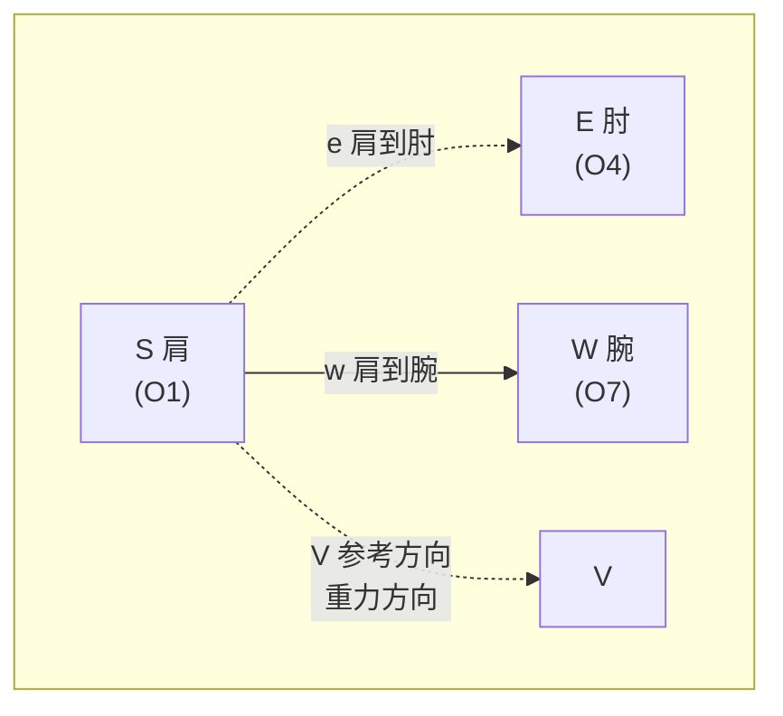
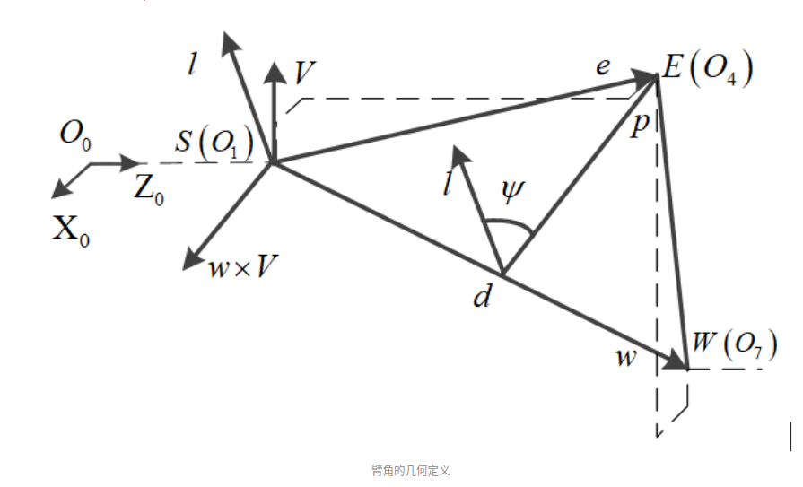
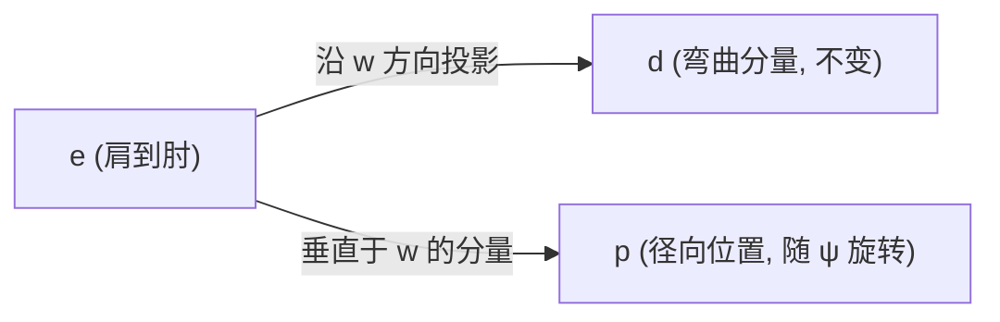

# WBC - 全身控制器设计详解

**目标**：控制一台轮式双臂机器人（Galaxea R1 Pro），让机械臂末端精确到达指定的空间位姿。

**关键问题**：目标可能很远，单靠手臂够不到 → 需要底盘、躯干、手臂**协同运动**。

## 文档结构

| 文档 / 章节 | 内容 |
|---|---|
| **第一章** WBC 方法分类与对比 | 按“优先级方式 × 有无不等式约束”两个维度，把四种方法放在一张图里对比，并链接到各方法的详细文档 |
| **第二章** 零空间投影的数学推导 | 伪逆、零空间、次任务投影的严格推导，以及臂角案例 |
| **[QP_WBC.md](QP_WBC.md)** 运动学 QP-WBC | 加权方法与带约束的 QP 方法：**加权最小二乘（本项目实现）**、**加权 QP（WQP）**、**分层 QP（HQP）** |
| **[QP_KKT_GUIDE.md](QP_KKT_GUIDE.md)** 有约束 QP 入门 | 从无约束 QP 出发推导 KKT 条件，以及 Active Set 迭代求解 |
| **[README.md](README.md)** | 运行示例、验证结果与项目进度 |

**阅读路线**：第一章（有哪些做法、各自的位置）→ 按需深入：严格分层的理论看第二章，加权最小二乘与带约束的 QP 方法看 [QP_WBC.md](QP_WBC.md)。

**符号约定**（全部文档统一）：决策变量 $\mathbf{v} = \dot{\mathbf{q}}$ 为受控自由度的速度；$\mathbf{J}$ 为任务雅可比；$\dot{\mathbf{x}}_{\text{des}}$ 为期望任务速度；控制周期 $dt = 2$ ms，每周期 $\mathbf{q} \leftarrow \mathbf{q} + \mathbf{v}\,dt$。

---

[TOC]

---

# 第一章 WBC方法分类与对比

> 本章把常见的四种 WBC 方法放在同一个框架下比较，帮助理解它们的关系并选择方案。

---

## 1.1 冗余度与零空间

**冗余度**：自由度数 > 任务维度。

例如 14 个自由度（3 底盘 + 4 躯干 + 7 手臂）控制 6 维末端任务：

$$
\text{冗余度} = 14 - 6 = 8
$$

**零空间**：不影响任务的运动构成的空间：

$$
\mathcal{N}(\mathbf{J}) = \{ \mathbf{v} \in \mathbb{R}^{n} \mid \mathbf{J}\mathbf{v} = \mathbf{0} \}
$$

$\mathbf{v} \in \mathcal{N}(\mathbf{J})$ 表示以速度 $\mathbf{v}$ 运动时，末端速度为零。冗余度越高，零空间越大，可用来完成次任务（避限位、保持姿态、避障等）的自由度越多。

---

## 1.2 方法分类：两个维度

各种 WBC 方法都在解同一个问题：**在冗余自由度中，按某种准则选出一个 $\mathbf{v}$**。它们的区别可以归结为两个**相互独立**的维度：

1. **多任务的优先级怎么体现**
   - **加权**（软优先级）：所有任务按权重加进一个目标函数，冲突时按权重折中；
   - **严格分层**：高优先级任务先满足，低优先级只能在其零空间内优化，绝不影响高优先级。
2. **能否处理不等式约束**（关节限位、速度限位、避障……）
   - **不能**：问题只有等式 / 二次代价，有**闭式解**；
   - **能**：需要 **QP 求解器**。

两个维度组合，得到四种方法：

| | 无不等式约束（闭式解） | 有不等式约束（QP 求解器） |
|---|---|---|
| **加权** | **方法 1：加权最小二乘**（1.3 节，本项目实现，[QP_WBC.md §1](QP_WBC.md#1-加权最小二乘本项目实现)） | **方法 3：加权 QP（WQP）**（1.5 节，[QP_WBC.md §7](QP_WBC.md#7-加权-qpwqp)） |
| **严格分层** | **方法 2：零空间投影**（1.4 节，[第二章](#第二章-零空间投影的数学推导)） | **方法 4：分层 QP（HQP）**（1.6 节，[QP_WBC.md §8](QP_WBC.md#8-分层-qphqp)） |

**同一行的两种方法是同一个优化问题**，只差不等式约束：
- WQP 去掉不等式约束 = 加权最小二乘；
- HQP 去掉不等式约束 = 零空间投影。

**同一列的两种方法**处理不等式约束的能力相同，区别只在优先级方式。

> 原先常见的“加权最小二乘 / 零空间投影 / 分层 QP”三分法，把两个维度混在了一起：前两者的区别是优先级方式，而分层 QP 与零空间投影的区别是有无不等式约束。这样分会漏掉右上角的加权 QP，也就是“在现有加权最小二乘上加入约束”这条最直接的升级路线。

---

## 1.3 方法 1：加权最小二乘

**本项目采用的方法**，详见 [QP_WBC.md §1](QP_WBC.md#1-加权最小二乘本项目实现)。

$$
\min_{\mathbf{v}} \tfrac12\|\mathbf{J}\mathbf{v} - \dot{\mathbf{x}}_{\text{des}}\|^2_{\mathbf{W}} + \tfrac{\lambda}{2}\|\mathbf{v}\|^2 + \tfrac12\|\mathbf{v} - \mathbf{v}_{\text{post}}\|^2_{\mathbf{W}_p}
$$

$$
\mathbf{v}^* = (\mathbf{J}^T\mathbf{W}\mathbf{J} + \lambda\mathbf{I} + \mathbf{W}_p)^{-1} (\mathbf{J}^T\mathbf{W}\dot{\mathbf{x}}_{\text{des}} + \mathbf{W}_p\mathbf{v}_{\text{post}})
$$

- 闭式解，解一个 $n \times n$ 线性方程组
- 主次任务按权重折中：次任务会轻微影响主任务
- $\lambda\mathbf{I}$ 保证可解，并抑制奇异附近的速度爆炸
- 不等式约束只能事后裁剪或用斥力近似

---

## 1.4 方法 2：零空间投影

**严格分层**的闭式方法（详见[第二章](#第二章-零空间投影的数学推导)）：

$$
\mathbf{v}^* = \mathbf{J}^\dagger \dot{\mathbf{x}}_{\text{des}} + \mathbf{N}\,\mathbf{v}_{\text{post}}, \qquad
\mathbf{N} = \mathbf{I} - \mathbf{J}^\dagger\mathbf{J}
$$

- 次任务被投影到主任务的零空间，满足 $\mathbf{J}\mathbf{N}\mathbf{v}_{\text{post}} = \mathbf{0}$，不影响主任务
- 可以递推到多层（第 $k$ 层投影到前 $k-1$ 层的零空间，见 [2.8 节](#28-推广到多层与分层-qp-的关系)）
- 需要计算伪逆；接近奇异时要用阻尼伪逆，此时严格隔离会被轻微破坏（[2.6 节](#26-阻尼伪逆数值稳定性与精度的权衡)）
- 不等式约束同样只能事后处理

---

## 1.5 方法 3：加权 QP（WQP）

方法 1 加上不等式约束：

$$
\min_{\mathbf{v}} \sum_i \tfrac{w_i}{2} \|\mathbf{J}_i\mathbf{v} - \dot{\mathbf{x}}_{d,i}\|^2_{\mathbf{W}_i} + \tfrac{\lambda}{2}\|\mathbf{v}\|^2 + \tfrac12\mathbf{v}^T\mathbf{R}\,\mathbf{v}
\quad \text{s.t.} \quad
\mathbf{lb} \leq \mathbf{v} \leq \mathbf{ub},\;\; \mathbf{lb}_A \leq \mathbf{A}\mathbf{v} \leq \mathbf{ub}_A
$$

- 目标函数与方法 1 相同，关节限位、速度限位变成 Box 约束，躯干范围、避碰等变成线性约束
- 需要 QP 求解器（qpOASES、OSQP、ProxQP 等），中小规模下实时可行
- 是本项目**改动最小的升级路线**：目标函数不变，只增加约束

详见 [QP_WBC.md §7](QP_WBC.md#7-加权-qpwqp)。

---

## 1.6 方法 4：分层 QP（HQP）

方法 2 加上不等式约束。按优先级逐层求解，每层把上层已达到的残差**锁定**为约束：

$$
\text{第 } k \text{ 层：}\quad
\min_{\mathbf{v}} \|\mathbf{J}_k\mathbf{v} - \dot{\mathbf{x}}_{d,k}\|^2
\quad \text{s.t.} \quad
\mathbf{J}_j\mathbf{v} - \dot{\mathbf{x}}_{d,j} = \mathbf{r}_j^*\;(j < k),\;\; \text{不等式约束}
$$

$\mathbf{r}_j^*$ 是第 $j$ 层求出的最优残差。

- 可以叠加任意多层（主任务 → 避障 → 姿态 → ……），不等式约束也可以作为某一层
- 每层解一个 QP，计算量约为 WQP 的层数倍

详见 [QP_WBC.md §8](QP_WBC.md#8-分层-qphqp)。

---

## 1.7 四种方法对比

| 维度 | 1 加权最小二乘 | 2 零空间投影 | 3 加权 QP | 4 分层 QP |
|---|---|---|---|---|
| **优先级** | 软（按权重折中） | 严格 | 软 | 严格 |
| **不等式约束** | 不能（事后裁剪） | 不能（事后裁剪） | 能 | 能 |
| **求解方式** | 解线性方程组 | 伪逆 + 投影 | 1 个 QP | 每层 1 个 QP |
| **计算量** | 最低 | 低 | 中 | 最高（约为 3 的层数倍） |
| **主任务精度** | 冲突时有小残差，取决于权重比 | 无冲突时精确（阻尼时近似） | 同 1 | 同 2，且满足约束 |
| **多层任务** | 靠权重区分，层次多时难调 | 可递推多层 | 靠权重区分 | 任意层 |
| **奇异处理** | $\lambda\mathbf{I}$ 自动处理 | 需阻尼伪逆 | $\lambda\mathbf{I}$ | 每层正则化 |
| **任务切换** | 权重连续变化，平滑 | 换层可能跳变 | 平滑 | 换层可能跳变 |
| **代码复杂度** | 低 | 中 | 中 | 高 |

> 具体的计算时间取决于自由度数、约束数和求解器。本项目的规模（14~21 维）下，四种方法都能满足 2 ms 控制周期的数量级要求，需要以实测为准。

**两个关键关系**（详细推导见 [QP_WBC.md §9](QP_WBC.md#9-wqp-与-hqp-的区别)）：
- 加权方法中，权重比 → ∞ 时趋于严格分层，但 $\mathbf{H}$ 会越来越病态，所以**不能靠把权重拉得极大来模拟严格优先级**；
- 闭式方法是对应 QP 方法去掉不等式约束的特例，所以从闭式方法升级到 QP 方法时，任务定义和权重设计都可以沿用。

---

## 1.8 选型

| 需求 | 推荐 | 原因 |
|---|---|---|
| 快速验证、无约束的到达任务 | 1 加权最小二乘 | 最简单、最快 |
| 需要直观演示“次任务不影响主任务” | 2 零空间投影 | 隔离严格，便于可视化（如 [2.7 节](#27-案例用标准臂角-psi-驱动零空间速度)臂角案例） |
| 需要硬限位、避碰，且任务很少冲突 | 3 加权 QP | 在方法 1 基础上加约束即可 |
| 需要“某任务必须保证” + 约束（如末端稳定优先于躯干轨迹） | 4 分层 QP | 严格优先级 + 约束 |
| 层数不多、既要优先级又要实时 | 混合（2~3 层 HQP，层内加权） | 实际工程中最常用 |

**本项目的现状与路线**：
- 方法 1 是原有实现（`wbc_function/wbc_controller.py` 的默认模式），控制周期短、目标为静止点、任务冲突少，加权的精度已足够；
- 零空间相关演示使用方法 2（[第二章](#第二章-零空间投影的数学推导)，`demo_*.py`）；
- 方法 3 已在 `wbc_function/wqp_solver.py` 中实现（`WQPSolver`，基于 qpOASES），把限位和速度上限变成了硬约束，解决了 [QP_WBC.md §1.5.4](QP_WBC.md#154-姿态项与限位处理的实际效果) 的问题；方法 1 也已封装为同一接口下的 `WLSSolver`（见 [QP_WBC.md §11](QP_WBC.md#11-代码结构wbc_function)）；
- 需要严格优先级时，再在同一接口上扩展方法 4。

---

## 1.9 演示代码

```bash
python3 nullspace_example.py
```

用一个数值示例对比加权与零空间方法：主任务误差、次任务完成度、零空间验证和计算时间。其中“分层 QP”部分只是用零空间投影的解析解做示意，没有接入真正的 QP 求解器。

---

# 第二章 零空间投影的数学推导

> 本章从实际问题出发，推导零空间投影的完整流程。它是 1.2 节中“严格分层 × 无不等式约束”的方法；加入不等式约束后即为分层 QP（[QP_WBC.md §8](QP_WBC.md#8-分层-qphqp)）。

---

## 2.1 问题引入

**场景**：机械臂够桌上的杯子。

- **主任务**：手到达杯子（6 维：3 位置 + 3 姿态）
- **观察**：手固定后，肘部仍可上抬或下垂，身体可前倾或后仰
- **问题**：如何利用这些“多余”的自由度完成次任务？

**数学形式化**：雅可比 $\mathbf{J} \in \mathbb{R}^{m \times n}$（$m = 6$，$n = 14$），主任务要求

$$
\mathbf{J}\mathbf{v} = \dot{\mathbf{x}}_{\text{des}}
$$

这是欠定系统（$m < n$），有无穷多解。次任务希望从这些解中选出最接近 $\mathbf{v}_{\text{post}}$ 的那个。

---

## 2.2 零空间：不影响主任务的运动

### 2.2.1 定义

$$
\mathcal{N}(\mathbf{J}) = \{ \mathbf{v} \in \mathbb{R}^{n} \mid \mathbf{J}\mathbf{v} = \mathbf{0} \}
$$

**物理含义**：$\mathbf{v} \in \mathcal{N}(\mathbf{J})$ 表示关节以速度 $\mathbf{v}$ 运动时，末端不动。

**性质**：
- 维度：$\dim\mathcal{N}(\mathbf{J}) = n - \text{rank}(\mathbf{J})$（行满秩时为 $n - m = 8$）
- 叠加性：对任意 $\mathbf{v}_n \in \mathcal{N}(\mathbf{J})$ 和任意 $\mathbf{v}$，有 $\mathbf{J}(\mathbf{v} + \mathbf{v}_n) = \mathbf{J}\mathbf{v}$

**回到场景**：肘部摆动对应的关节速度属于 $\mathcal{N}(\mathbf{J})$，叠加到任何满足主任务的速度上都不改变手的运动。

### 2.2.2 用 SVD 求零空间的基

$$
\mathbf{J} = \mathbf{U}\mathbf{\Sigma}\mathbf{V}^T
$$

- $\mathbf{U} \in \mathbb{R}^{m \times m}$：左奇异向量（正交）
- $\mathbf{\Sigma} \in \mathbb{R}^{m \times n}$：$\text{diag}(\sigma_1, \ldots, \sigma_m)$ 右侧补零
- $\mathbf{V} \in \mathbb{R}^{n \times n}$：右奇异向量（正交），列记为 $\mathbf{v}_1, \ldots, \mathbf{v}_n$

设 $\text{rank}(\mathbf{J}) = r$（行满秩时 $r = m$），**零空间的基是 $\mathbf{V}$ 的后 $n - r$ 列**：

$$
\mathcal{N}(\mathbf{J}) = \text{span}\{ \mathbf{v}_{r+1}, \ldots, \mathbf{v}_n \}
$$

**证明**：对 $i > r$，$\mathbf{J}\mathbf{v}_i = \mathbf{U}\mathbf{\Sigma}\mathbf{V}^T\mathbf{v}_i = \mathbf{U}\mathbf{\Sigma}\mathbf{e}_i = \mathbf{0}$，因为 $\mathbf{\Sigma}$ 的第 $i$ 列全为零。

---

## 2.3 解的分解：特解 + 零空间分量

### 2.3.1 通解形式

$$
\mathbf{v} = \mathbf{v}_{\text{particular}} + \mathbf{v}_{\text{null}}
$$

- $\mathbf{v}_{\text{particular}}$：任意一个特解，满足 $\mathbf{J}\mathbf{v}_{\text{particular}} = \dot{\mathbf{x}}_{\text{des}}$
- $\mathbf{v}_{\text{null}} \in \mathcal{N}(\mathbf{J})$：零空间中的任意向量

### 2.3.2 最小范数特解：Moore-Penrose 伪逆

在所有特解中选范数最小的：

$$
\mathbf{v}_{\text{particular}} = \mathbf{J}^\dagger \dot{\mathbf{x}}_{\text{des}}, \qquad
\mathbf{J}^\dagger = \mathbf{V}\mathbf{\Sigma}^\dagger\mathbf{U}^T
$$

$\mathbf{\Sigma}^\dagger \in \mathbb{R}^{n \times m}$ 把非零奇异值取倒数、再转置。$\mathbf{J}$ **行满秩**时有等价形式 $\mathbf{J}^\dagger = \mathbf{J}^T(\mathbf{J}\mathbf{J}^T)^{-1}$。

**Moore-Penrose 伪逆的四个定义性质**（对任何秩都成立）：

$$
\mathbf{J}\mathbf{J}^\dagger\mathbf{J} = \mathbf{J}, \quad
\mathbf{J}^\dagger\mathbf{J}\mathbf{J}^\dagger = \mathbf{J}^\dagger, \quad
(\mathbf{J}\mathbf{J}^\dagger)^T = \mathbf{J}\mathbf{J}^\dagger, \quad
(\mathbf{J}^\dagger\mathbf{J})^T = \mathbf{J}^\dagger\mathbf{J}
$$

由此得到：
1. $\mathbf{J}\mathbf{J}^\dagger = \mathbf{I}_m$（右逆）——**仅在行满秩时成立**；
2. $\mathbf{J}^\dagger\mathbf{J} \neq \mathbf{I}_n$（$m < n$ 时不是左逆）；
3. $\mathbf{J}^\dagger\mathbf{J}$ 是到 $\mathbf{J}$ 行空间的**正交投影**（对称且幂等）。

后面的推导只用这四个性质，因此对秩亏的情况也成立。

### 2.3.3 用 SVD 理解伪逆

**核心思想**：SVD 把矩阵分解为“旋转–缩放–旋转”，伪逆就是反向旋转、对非零方向反向缩放。

$$
\mathbf{J} = \mathbf{U}\mathbf{\Sigma}\mathbf{V}^T, \qquad
\mathbf{\Sigma} = \begin{bmatrix} \sigma_1 & & & \\ & \ddots & & \mathbf{0} \\ & & \sigma_m & \end{bmatrix}, \qquad
\mathbf{\Sigma}^\dagger = \begin{bmatrix} 1/\sigma_1 & & \\ & \ddots & \\ & & 1/\sigma_m \\ & \mathbf{0} & \end{bmatrix}
$$

**验证右逆**（行满秩，$\sigma_m > 0$）：

$$
\mathbf{J}\mathbf{J}^\dagger = \mathbf{U}\mathbf{\Sigma}(\mathbf{V}^T\mathbf{V})\mathbf{\Sigma}^\dagger\mathbf{U}^T = \mathbf{U}\mathbf{\Sigma}\mathbf{\Sigma}^\dagger\mathbf{U}^T = \mathbf{U}\mathbf{I}_m\mathbf{U}^T = \mathbf{I}_m
$$

**验证投影**：

$$
\mathbf{J}^\dagger\mathbf{J} = \mathbf{V}\mathbf{\Sigma}^\dagger\mathbf{\Sigma}\mathbf{V}^T = \mathbf{V}\begin{bmatrix} \mathbf{I}_m & \mathbf{0} \\ \mathbf{0} & \mathbf{0} \end{bmatrix}\mathbf{V}^T
$$

这是到 $\mathbf{V}$ 前 $m$ 列张成的空间（即行空间）的正交投影。

**与 $\mathbf{J}^T(\mathbf{J}\mathbf{J}^T)^{-1}$ 等价**（行满秩）：

$$
\mathbf{J}^T(\mathbf{J}\mathbf{J}^T)^{-1}
= \mathbf{V}\mathbf{\Sigma}^T\mathbf{U}^T(\mathbf{U}\mathbf{\Sigma}\mathbf{\Sigma}^T\mathbf{U}^T)^{-1}
= \mathbf{V}\mathbf{\Sigma}^T(\mathbf{\Sigma}\mathbf{\Sigma}^T)^{-1}\mathbf{U}^T
= \mathbf{V}\mathbf{\Sigma}^\dagger\mathbf{U}^T
$$

最后一步：$\mathbf{\Sigma}\mathbf{\Sigma}^T = \text{diag}(\sigma_i^2)$，所以 $\mathbf{\Sigma}^T(\mathbf{\Sigma}\mathbf{\Sigma}^T)^{-1}$ 的对角元为 $\sigma_i/\sigma_i^2 = 1/\sigma_i$。

### 2.3.4 SVD 求伪逆的优缺点

**优点**：
1. **数值稳定**：不需要显式求 $(\mathbf{J}\mathbf{J}^T)^{-1}$，后者会把条件数平方；
2. **适用于任何秩**：秩亏时只对非零奇异值取倒数；
3. **几何直观**：同时给出行空间、零空间的基，以及最小奇异值 $\sigma_{\min}$（离奇异有多远）。

**缺点：阈值截断会导致跳变**。常见做法是把小于阈值的奇异值直接置零。但当 $\sigma_i$ 从阈值上方连续减小、越过阈值时，对应的 $1/\sigma_i$ 会从一个很大的值**突然变成 0**，解不连续，关节速度跳变。实时控制中更推荐 2.6 节的**阻尼**做法，它让 $1/\sigma_i$ 平滑地变为 $\sigma_i/(\sigma_i^2 + \lambda)$。

```python
U, S, Vt = np.linalg.svd(J, full_matrices=False)   # S = [σ1, ..., σm]

# 截断伪逆：小奇异值直接置零（会在阈值处跳变）
S_inv = np.where(S > 1e-10, 1.0 / S, 0.0)
J_pinv = Vt.T @ np.diag(S_inv) @ U.T

# 阻尼伪逆：平滑过渡（推荐用于实时控制，见 2.6 节）
S_damped = S / (S**2 + lam)
J_pinv_damped = Vt.T @ np.diag(S_damped) @ U.T
```

---

## 2.4 零空间投影矩阵

### 2.4.1 定义

$$
\mathbf{N} = \mathbf{I} - \mathbf{J}^\dagger\mathbf{J}
$$

**作用**：把任意向量投影到 $\mathcal{N}(\mathbf{J})$。

### 2.4.2 性质证明

以下证明只用到 2.3.2 节的伪逆定义性质，对任何秩都成立。

**性质 1：幂等** $\mathbf{N}^2 = \mathbf{N}$

$$
\mathbf{N}^2 = \mathbf{I} - 2\mathbf{J}^\dagger\mathbf{J} + \mathbf{J}^\dagger(\mathbf{J}\mathbf{J}^\dagger\mathbf{J})
= \mathbf{I} - 2\mathbf{J}^\dagger\mathbf{J} + \mathbf{J}^\dagger\mathbf{J}
= \mathbf{N}
$$

（用到 $\mathbf{J}\mathbf{J}^\dagger\mathbf{J} = \mathbf{J}$。）

**性质 2：对称** $\mathbf{N}^T = \mathbf{N}$，因为 $(\mathbf{J}^\dagger\mathbf{J})^T = \mathbf{J}^\dagger\mathbf{J}$。幂等且对称，说明 $\mathbf{N}$ 是**正交**投影。

**性质 3：投影结果在零空间内** $\mathbf{J}\mathbf{N} = \mathbf{0}$

$$
\mathbf{J}\mathbf{N} = \mathbf{J} - \mathbf{J}\mathbf{J}^\dagger\mathbf{J} = \mathbf{J} - \mathbf{J} = \mathbf{0}
$$

**性质 4：$\text{Range}(\mathbf{N}) = \mathcal{N}(\mathbf{J})$**

- $\subseteq$：对任意 $\mathbf{v} = \mathbf{N}\mathbf{x}$，$\mathbf{J}\mathbf{v} = \mathbf{J}\mathbf{N}\mathbf{x} = \mathbf{0}$；
- $\supseteq$：对任意 $\mathbf{v} \in \mathcal{N}(\mathbf{J})$，$\mathbf{N}\mathbf{v} = \mathbf{v} - \mathbf{J}^\dagger(\mathbf{J}\mathbf{v}) = \mathbf{v}$。

---

## 2.5 次任务投影：完整流程

### 2.5.1 问题设定

- 主任务：$\mathbf{J}\mathbf{v} = \dot{\mathbf{x}}_{\text{des}}$（精确满足）
- 次任务：希望 $\mathbf{v}$ 接近某个期望速度 $\mathbf{v}_{\text{post}}$

**$\mathbf{v}_{\text{post}}$ 是速度量，不能直接等于位置目标**（如关节中位 $q_{\text{mid}}$）。当次任务是让关节趋向某个位置（中位、远离障碍、可操作度最大化等）时，先定义一个标量指标 $H(q)$，再用**梯度投影法**（Liégeois, 1977）把它的梯度转成速度指令：

$$
\mathbf{v}_{\text{post}} = k_0\, \nabla H(q)
$$

例如中位指标 $H(q) = -\frac{1}{2}\sum_i (q_i - q_{\text{mid},i})^2$，$\nabla H = -(q - q_{\text{mid}})$，得到最常见的形式（等价于比例控制）：

$$
\mathbf{v}_{\text{post}} = k_0\,(q_{\text{mid}} - q)
$$

如果次任务目标是随时间变化的轨迹 $q_d(t)$，再加上前馈：

$$
\mathbf{v}_{\text{post}} = k_p\,(q_d(t) - q) + \dot{q}_d(t)
$$

**目标**：

$$
\min_{\mathbf{v}} \|\mathbf{v} - \mathbf{v}_{\text{post}}\|^2 \quad \text{s.t.} \quad \mathbf{J}\mathbf{v} = \dot{\mathbf{x}}_{\text{des}}
$$

### 2.5.2 解的构造

**步骤 1**：主任务的最小范数解 $\mathbf{v}_1 = \mathbf{J}^\dagger\dot{\mathbf{x}}_{\text{des}}$

**步骤 2**：次任务只能在零空间内调整，投影：$\mathbf{v}_2 = \mathbf{N}(\mathbf{v}_{\text{post}} - \mathbf{v}_1)$

**步骤 3**：合成

$$
\mathbf{v}^* = \mathbf{v}_1 + \mathbf{N}(\mathbf{v}_{\text{post}} - \mathbf{v}_1)
$$

由于 $\mathbf{N}\mathbf{v}_1 = (\mathbf{I} - \mathbf{J}^\dagger\mathbf{J})\mathbf{J}^\dagger\dot{\mathbf{x}} = (\mathbf{J}^\dagger - \mathbf{J}^\dagger\mathbf{J}\mathbf{J}^\dagger)\dot{\mathbf{x}} = \mathbf{0}$，化简为：

$$
\boxed{\;\mathbf{v}^* = \mathbf{J}^\dagger\dot{\mathbf{x}}_{\text{des}} + \mathbf{N}\,\mathbf{v}_{\text{post}}\;}
$$

### 2.5.3 验证

**主任务**（行满秩时）：

$$
\mathbf{J}\mathbf{v}^* = \mathbf{J}\mathbf{J}^\dagger\dot{\mathbf{x}}_{\text{des}} + \mathbf{J}\mathbf{N}\mathbf{v}_{\text{post}} = \dot{\mathbf{x}}_{\text{des}} + \mathbf{0}
$$

主任务精确满足 ✅。（秩亏时，$\mathbf{J}\mathbf{v}^*$ 是 $\dot{\mathbf{x}}_{\text{des}}$ 在可达方向上的投影，即最小二乘意义下最优。）

**次任务**：在所有满足主任务的解中，$\mathbf{v}^*$ 使 $\|\mathbf{v} - \mathbf{v}_{\text{post}}\|^2$ 最小，证明见下节。

### 2.5.4 最优性证明

满足主任务的解都可写为 $\mathbf{v} = \mathbf{v}_1 + \mathbf{N}\mathbf{w}$（性质 4）。问题变为对 $\mathbf{w}$ 的无约束最小化：

$$
\min_{\mathbf{w}} \|\mathbf{v}_1 + \mathbf{N}\mathbf{w} - \mathbf{v}_{\text{post}}\|^2
$$

对 $\mathbf{w}$ 求导令其为零，利用 $\mathbf{N}^T = \mathbf{N}$、$\mathbf{N}^T\mathbf{N} = \mathbf{N}$：

$$
2\mathbf{N}(\mathbf{v}_1 - \mathbf{v}_{\text{post}}) + 2\mathbf{N}\mathbf{w} = \mathbf{0}
\;\Longrightarrow\;
\mathbf{N}\mathbf{w}^* = \mathbf{N}(\mathbf{v}_{\text{post}} - \mathbf{v}_1)
$$

所以

$$
\mathbf{v}^* = \mathbf{v}_1 + \mathbf{N}(\mathbf{v}_{\text{post}} - \mathbf{v}_1) = \mathbf{J}^\dagger\dot{\mathbf{x}}_{\text{des}} + \mathbf{N}\mathbf{v}_{\text{post}}
$$

目标函数关于 $\mathbf{w}$ 是凸的，驻点即全局最优。

---

## 2.6 阻尼伪逆：数值稳定性与精度的权衡

### 2.6.1 纯伪逆的问题

接近奇异时 $\sigma_{\min} \to 0$，伪逆中的 $1/\sigma_{\min} \to \infty$：末端一个很小的期望速度，也会要求关节以极大速度运动，表现为关节**跳变**。若用 $\mathbf{J}^T(\mathbf{J}\mathbf{J}^T)^{-1}$ 计算，$\kappa(\mathbf{J}\mathbf{J}^T) = \sigma_{\max}^2/\sigma_{\min}^2$，数值误差也会被放大。

### 2.6.2 阻尼伪逆

$$
\mathbf{J}^\dagger_\lambda = \mathbf{J}^T(\mathbf{J}\mathbf{J}^T + \lambda\mathbf{I})^{-1} = (\mathbf{J}^T\mathbf{J} + \lambda\mathbf{I})^{-1}\mathbf{J}^T
$$

在 SVD 下，每个方向的增益从 $1/\sigma_i$ 变为

$$
\frac{\sigma_i}{\sigma_i^2 + \lambda}
\quad\begin{cases}
\approx 1/\sigma_i, & \sigma_i \gg \sqrt{\lambda}\;\;\text{（远离奇异：几乎不受影响）} \\
\leq \dfrac{1}{2\sqrt{\lambda}}, & \text{任何情况（关节速度有上界）} \\
\to 0, & \sigma_i \to 0\;\;\text{（平滑地放弃该方向）}
\end{cases}
$$

它等价于[加权最小二乘](QP_WBC.md#1-加权最小二乘本项目实现)只保留主任务和阻尼项（$\mathbf{W} = \mathbf{I}$，$\mathbf{W}_p = \mathbf{0}$），所以加权最小二乘中的 $\lambda\mathbf{I}$ 起的就是同样的作用。

**代价**：
1. **主任务不再精确满足**：远离奇异时误差约为 $\lambda/\sigma_i^2$ 量级，接近奇异时该方向基本被放弃；
2. **零空间隔离被轻微破坏**：用 $\mathbf{N}_\lambda = \mathbf{I} - \mathbf{J}^\dagger_\lambda\mathbf{J}$ 时，

$$
\mathbf{J}\mathbf{N}_\lambda = \mathbf{J} - \mathbf{J}\mathbf{J}^\dagger_\lambda\mathbf{J} = \lambda(\mathbf{J}\mathbf{J}^T + \lambda\mathbf{I})^{-1}\mathbf{J} \neq \mathbf{0}
$$

   在每个奇异方向上，次任务会以 $\lambda/(\sigma_i^2 + \lambda)$ 的比例“漏”进主任务。远离奇异时可以忽略，接近奇异时会变得明显。

**实用做法**：
- 主任务特解用阻尼伪逆（保证平滑）；
- 投影矩阵 $\mathbf{N}$ 用 SVD 直接构造（取 $\mathbf{V}$ 中 $\sigma_i$ 很小的那些列张成零空间），或者接受轻微泄漏；
- 也可以只在接近奇异时启用阻尼：$\lambda$ 随 $\sigma_{\min}$ 自适应变化，例如 $\lambda = \lambda_0\,(1 - (\sigma_{\min}/\sigma_0)^2)$（$\sigma_{\min} < \sigma_0$ 时），否则 $\lambda = 0$。

> 本章 2.2–2.5 节的推导基于纯伪逆，结论在远离奇异时成立；实际实现几乎总要引入阻尼，此时上述两点代价需要考虑。

---

## 2.7 案例：用标准臂角 $\psi$ 驱动零空间速度

前几节的次任务都直接定义在关节空间。本节给出另一类常用做法：**先定义一个有物理意义的标量指标 $\psi(q)$（臂角），控制它的变化率，再通过 $\psi$ 的雅可比映射回关节速度**。这是 7 自由度冗余臂（3+1+3，SRS 构型）零空间参数化最常用的方法之一。

### 2.7.1 问题背景

SRS 构型 7 自由度臂（肩 3 + 肘 1 + 腕 3）末端位姿固定时，还剩 $7 - 6 = 1$ 维零空间。这个自由度不是某个关节角，而是**肘部绕“肩–腕连线”自转的相位**：末端固定时，肩点 $S$、腕点 $W$ 都不动，只有肘点 $E$ 能在以 $SW$ 为轴的圆上滑动。肘部在圆上转到哪个角度，就是臂角 $\psi$。

> 在本机器人上，如果把躯干和底盘也算进来，零空间的维度会更高。本案例只用手臂关节完成臂角摆动，$\psi$ 对应的是手臂自身的那 1 维自运动。

**为什么用 $\psi$ 而不用单个关节角**（如 `left_joint3`）：$\psi$ 严格对应这唯一的自运动自由度，是几何不变量；单个关节角混杂了肘部弯曲和自转两种效应，用作零空间指标时容易产生歧义。

### 2.7.2 臂角的几何定义

设肩、肘、腕的世界坐标为 $\mathbf{p}_S, \mathbf{p}_E, \mathbf{p}_W$：

$$
\mathbf{e} = \mathbf{p}_E - \mathbf{p}_S \;(\text{肩到肘}), \qquad
\mathbf{w} = \mathbf{p}_W - \mathbf{p}_S \;(\text{肩到腕})
$$

再选一个**参考方向** $\mathbf{V}$，用于确定 $\psi = 0$ 的基准。本项目取世界坐标 $-Z$（重力方向）。





以 $\mathbf{w}$ 为轴，构造垂直于 $\mathbf{w}$ 的参考方向：

$$
\hat{\mathbf{w}} = \frac{\mathbf{w}}{\|\mathbf{w}\|}, \qquad
\mathbf{l} = (\mathbf{w} \times \mathbf{V}) \times \mathbf{w}, \qquad
\hat{\mathbf{l}} = \frac{\mathbf{l}}{\|\mathbf{l}\|}
$$

$\mathbf{l}$ 是 $\mathbf{V}$ 在垂直于 $\mathbf{w}$ 的平面内的投影方向，作为 $\psi = 0$ 的基准。

把 $\mathbf{e}$ 分解为沿 $\mathbf{w}$ 和垂直于 $\mathbf{w}$ 的两部分：

$$
\mathbf{d} = \hat{\mathbf{w}}(\hat{\mathbf{w}}^T\mathbf{e}), \qquad
\mathbf{p} = \mathbf{e} - \mathbf{d} = (\mathbf{I} - \hat{\mathbf{w}}\hat{\mathbf{w}}^T)\,\mathbf{e}
$$

- $\mathbf{d}$：沿肩腕轴的分量，反映肘部弯曲程度，自运动时不变；
- $\mathbf{p}$：垂直于肩腕轴的径向分量，**随自运动旋转**。



**臂角** $\psi$ 是 $\mathbf{p}$ 相对参考方向在垂直平面内转过的有符号角度：

$$
\psi = \operatorname{atan2}\!\big(\hat{\mathbf{w}}^T(\hat{\mathbf{V}} \times \mathbf{p}),\; \hat{\mathbf{V}}^T\mathbf{p}\big), \qquad \hat{\mathbf{V}} = \frac{\mathbf{V}}{\|\mathbf{V}\|}
$$

这里用 $\hat{\mathbf{V}}$ 和用 $\hat{\mathbf{l}}$ 得到的 $\psi$ 相同：因为 $\mathbf{p} \perp \mathbf{w}$，有 $\mathbf{l}^T\mathbf{p} = \|\mathbf{w}\|^2\,\mathbf{V}^T\mathbf{p}$，atan2 的两个参数被同一个正数缩放，角度不变。

$\psi$ 可以连续跨越 $\pm 180°$。注意不要和“肘部偏离肩腕连线的夹角” $\operatorname{atan2}(\|\mathbf{p}\|, \|\mathbf{d}\|)$ 混淆：后者恒非负、反映弯曲程度，自运动时几乎不变；前者才是自运动的相位。

### 2.7.3 臂角雅可比 $\mathbf{J}_c$

$$
\dot\psi = \mathbf{J}_c\,\dot{\mathbf{q}}, \qquad \mathbf{J}_c \in \mathbb{R}^{1 \times n}
$$

由肘部位置雅可比 $\mathbf{J}_1 = \partial\mathbf{p}_E/\partial\mathbf{q}$ 和腕部位置雅可比 $\mathbf{J}_2 = \partial\mathbf{p}_W/\partial\mathbf{q}$（均为 $3 \times n$）组装：

$$
\mathbf{J}_c = \frac{(\hat{\mathbf{w}} \times \hat{\mathbf{p}})^T}{\|\mathbf{p}\|}\,\mathbf{J}_1
+ \left\{ \frac{\mathbf{V}^T\mathbf{w}}{\|\mathbf{l}\|}\,(\hat{\mathbf{w}} \times \hat{\mathbf{l}})^T
- \frac{\hat{\mathbf{w}}^T\mathbf{e}}{\|\mathbf{w}\|\,\|\mathbf{p}\|}\,(\hat{\mathbf{w}} \times \hat{\mathbf{p}})^T \right\} \mathbf{J}_2
$$

本案例中肩点 $S$ 不随受控关节运动，所以 $\partial\mathbf{e}/\partial\mathbf{q} = \mathbf{J}_1$、$\partial\mathbf{w}/\partial\mathbf{q} = \mathbf{J}_2$。如果肩点会动（如躯干也参与），需在 $\mathbf{J}_1$、$\mathbf{J}_2$ 中分别减去肩部位置雅可比。

$\mathbf{J}_1$、$\mathbf{J}_2$ 直接用 `mj_jacBody` / `mj_jacSite` 计算（[QP_WBC.md §1.2.2](QP_WBC.md#122-末端速度与全身速度的关系)）。

### 2.7.4 零空间速度合成

把“臂角按轨迹 $\psi_d(t)$ 摆动”构造成 2.5 节的 $\mathbf{v}_{\text{post}}$：

**第 1 步**：期望臂角轨迹 → 期望臂角速度（位置目标必须先转成速度，见 2.5.1 节）：

$$
\dot\psi_{\text{cmd}} = k_p\,(\psi_d(t) - \psi) + k_d\,\dot\psi_d(t)
$$

**第 2 步**：标量速度 → 关节速度。求使 $\mathbf{J}_c\mathbf{v}_{\text{post}} = \dot\psi_{\text{cmd}}$ 的最小范数解（行向量的伪逆）：

$$
\mathbf{v}_{\text{post}} = \frac{\mathbf{J}_c^T}{\mathbf{J}_c\mathbf{J}_c^T}\,\dot\psi_{\text{cmd}}
$$

**第 3 步**：投影到主任务（双手末端固定）的零空间：

$$
\mathbf{v}^* = \mathbf{J}^\dagger\dot{\mathbf{x}}_{\text{des}} + \mathbf{N}\,\mathbf{v}_{\text{post}}
$$

注意区分两个雅可比：$\mathbf{J}$（双手末端，12 行）决定“什么运动不影响末端”；$\mathbf{J}_c$（臂角，1 行）决定“关节怎么动才能让 $\psi$ 按预期变化”。

由于 $\mathbf{v}_{\text{post}}$ 被投影后，$\mathbf{J}_c\mathbf{N}\mathbf{v}_{\text{post}}$ 一般不再精确等于 $\dot\psi_{\text{cmd}}$，实际摆动幅度会比指令小一些。若要让臂角也被精确跟踪，可以把它作为第 2 层任务，用多层零空间投影（2.8 节）求解。

### 2.7.5 与代码的对应（`demo_arm_angle_swivel.py`）

| 数学量 | 代码 |
|---|---|
| $\mathbf{p}_S, \mathbf{p}_E, \mathbf{p}_W$ | `d.xpos[shoulder_body]`、`d.xpos[elbow_body]`、`d.site_xpos[wrist_site]` |
| $\psi$ 及中间几何量 | `compute_swivel_geometry()` |
| $\mathbf{J}_1, \mathbf{J}_2$ | `wbc.body_jacobian("left_link4")`、`wbc.site_jacobian("left_ee")[:3, :]` |
| $\mathbf{J}_c$（解析） | `compute_Jc_analytical()` |
| $\mathbf{J}_c$（有限差分校验） | `compute_Jc_fd()`：逐关节扰动后重算 $\psi$，只用于校验，不参与控制 |
| $\mathbf{J}^\dagger$、$\mathbf{N}$ | 阻尼伪逆 `J.T @ inv(J @ J.T + 0.01*I)`，`N = I - J_pinv @ J`（2.6 节的 $\mathbf{N}_\lambda$） |
| $\dot\psi_{\text{cmd}}$ | `kp_psi * (psi_des - psi) + kd_psi * psi_des_dot`（`kp_psi = 4.0`，`kd_psi = 0.3`） |
| $\mathbf{v}_{\text{post}}$ | `v_secondary += (Jc / (Jc @ Jc)) * psidot_cmd` |
| $\mathbf{v}^*$ | `qd_total = qd_main + null_gain * (N @ v_secondary)`（`null_gain = 0.5`） |

**结果**：解析 $\mathbf{J}_c$ 与有限差分的最大误差约 $5 \times 10^{-7}$；双手末端误差稳定在 2 mm 以内，同时 $\psi$ 按正弦轨迹连续摆动（指令幅度 `psi_amplitude = 25°`，频率 0.5 Hz）。实际幅度小于指令，原因有三：`null_gain = 0.5` 直接打折；PD 跟踪在该频率下有相位滞后和幅值衰减；投影后 $\mathbf{J}_c\mathbf{N}\mathbf{v}_{\text{post}} \neq \mathbf{J}_c\mathbf{v}_{\text{post}}$。

> 参考：[七自由度冗余机械臂扩展任务逆运动学：扩展雅可比法](https://cloud.tencent.com/developer/article/1737044?policyId=1004)

---

## 2.8 推广到多层，与分层 QP 的关系

2.5 节只有两层（主任务 + 次任务）。按优先级排列的 $K$ 个任务 $(\mathbf{J}_k, \dot{\mathbf{x}}_k)$ 可以递推求解：

$$
\mathbf{v}_1 = \mathbf{J}_1^\dagger\dot{\mathbf{x}}_1, \qquad
\mathbf{v}_k = \mathbf{v}_{k-1} + (\mathbf{J}_k\mathbf{N}_{k-1})^\dagger(\dot{\mathbf{x}}_k - \mathbf{J}_k\mathbf{v}_{k-1}), \qquad
\mathbf{N}_{k-1} = \mathbf{I} - \bar{\mathbf{J}}_{k-1}^\dagger\bar{\mathbf{J}}_{k-1}
$$

其中 $\bar{\mathbf{J}}_{k-1} = [\mathbf{J}_1; \ldots; \mathbf{J}_{k-1}]$ 是前 $k-1$ 层雅可比的堆叠。第 $k$ 层的修正量被限制在前面所有层的零空间里，所以不会影响高优先级任务。

当 $K = 2$、第 2 层为“$\mathbf{v}$ 接近 $\mathbf{v}_{\text{post}}$”（$\mathbf{J}_2 = \mathbf{I}$）时，退化为 2.5 节的结果。

**与分层 QP 的关系**：零空间投影只能处理等式任务，关节限位等不等式约束只能在求解后裁剪，而裁剪会破坏层间隔离。**分层 QP（HQP）在每一层都加入不等式约束**，可以看作“能处理不等式约束的零空间投影”；去掉不等式约束后，HQP 的解与上面的递推公式一致。详见 [QP_WBC.md §8](QP_WBC.md#8-分层-qphqp)。

---

**机器人模型**：`assets/galaxea_r1pro_standalone/`
**主要依赖**：MuJoCo 3.2+，NumPy 1.26+
